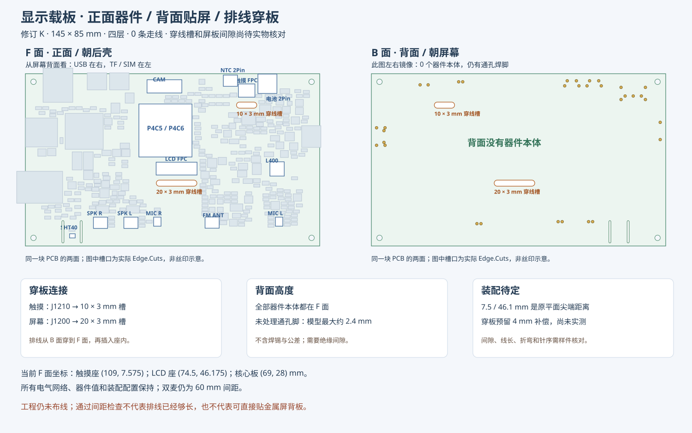

# 修订 K：正面器件、背面贴屏、排线穿板

2026-09-23。按本轮要求重新定义：**F 面是朝后壳的器件正面，B 面是朝屏幕金属背板的背面**。触摸/LCD 座、两个上部高 2Pin 接口及所有其他器件本体均在 F 面；B 面无器件本体。这里的“贴屏”仍需绝缘间隙，未表示金属背板可以直接压住焊脚。

## 坐标与接口位置

本文件采用从 F 面看向屏幕背面的视角，板框左上角为 (0,0)，X 右、Y 下；KiCad 文件坐标另加 (50,50) mm。与旧版屏幕正视投影的换算为 **X新=145−X旧**，Y 不变。因此 USB 在本视图右侧，SIM/TF 在左侧；从屏幕正面看，仍是 USB 左、SIM/TF 右。板框 145×85 mm、四层、安装孔和屏幕内偏移 (9.93,2.50) mm 保持。

| 器件 | F 面原点 X / Y（mm） | 角度 | 本轮动作 |
| --- | --- | --- | --- |
| J1210 触摸 FPC | 109 / 7.575 | 0° | 入口朝下，穿板后从 F 面插接 |
| J1200 LCD FPC | 74.5 / 46.175 | 0° | 入口朝下，核心板上移让开插接空间 |
| J1220 摄像头 FPC | 68.5 / 7 | 180° | 朝上出线，未新增摄像头穿板槽 |
| J300 电池 2Pin | 121 / 5.5 | 180° | 从 B 移到 F，10 A 接口型号保持 |
| J301 NTC 2Pin | 102 / 4 | 180° | 从 B 移到 F |
| J810 FM 天线 2Pin | 93 / 74 | 180° | 同步移至 F |
| J820 / J821 双扬声器 2Pin | 51 / 73；36 / 73 | 0° | 均在 F 面，远离屏背 |
| U100 核心板 | 69 / 28 | 0° | F 面，上移 8 mm，让开 LCD 座 |
| L400 小型电感 | 124 / 47 | 180° | 型号保持 FEXU0640S2R2MGS，移至 F |
| U802 / U803 双麦 | 125 / 73；65 / 73 | 180° | 直接焊载板 F 面，间距仍为 60 mm |
| U1300 / U1301 光照/温湿度 | 87 / 4；23 / 80 | 180° | F 面，后壳仍需光窗及独立通风腔 |

侧滑开关 SW310 移至 F 面 (20,11) mm，避开安装孔庭院。其余需要让位的阻容、接口转换器及测试点在各自功能区内重新初摆；完整位置见 `SCREEN_BACK_LAYOUT.json`。没有更换器件型号、引脚网络、默认装配或 P4/C6 下载结构。

## 实际穿线槽

| 用途 | 中心 X / Y（mm） | 总宽×高（mm） | 端部 |
| --- | --- | --- | --- |
| 触摸排线 | 109 / 15.5 | 10×3 | R1.5 圆端 |
| LCD 排线 | 74.5 / 54 | 20×3 | R1.5 圆端 |

这是 **Edge.Cuts 中的真实板内铣槽**，不是丝印或参考方框。圆端由 15° 弦段近似，制造时应与板厂确认槽形及边缘处理。槽周围建立四铜层禁止铜线、过孔、焊盘及铺铜区域；槽到座之间建立 F 面器件禁布区。旧版横贯整板的 F 面平铺排线通道已删除。另保留两条 1×11 mm 温湿度隔热槽；原生板框解析为一个外轮廓、四个内部闭合开口。

装配路径为 **屏幕排线 → B 面 → 对应穿线槽 → F 面 → FPC 座**。槽宽包含预留余量，但不是对所购触摸尾端/补强片的实测尺寸。板槽边缘需去毛刺并配置适当的绝缘护边，不能让 FPC 长期压在锐利 FR4 边缘上。

用户确认的触摸 **7.5 mm**、LCD **46.1 mm** 是原折法在平面上的顶部至金手指尖端距离。穿板加入了高度和弯折路径，不能继续直接套用平面座位置。因此本轮把两座沿 Y 暂向下移动 **4 mm**，作为便于装配试验的长度补偿；**4 mm 是设计预留，未测量也未证明足够**。屏板间隙、自由线长、弯曲半径、完全插入、开盖空间、针 1 方向和触摸针序仍需实物确认。不得强拉排线或把双接触座理解为可任意翻面而不影响针序。

## B 面剩余突出物

327 个实体器件（默认装 320、7 个 DNP）全部在 F 面，B 面设置整板器件禁布区。**背面仍有通孔焊脚**，不能用“0 个背面器件”推导出“0 高度”。按现有模型和 1.6 mm 板厚估算：

| 接口/开关 | B 面名义露出高度 |
| --- | ---: |
| J300 电池座 | 约 2.10 mm |
| J301/J810/J820/J821 PH 座 | 约 1.80 mm |
| SW101/SW102 侧按键 | 约 2.39 mm |
| SW310 侧滑开关 | 约 1.90 mm |

完整 CAD 包络记录为 `SCREEN_BACK_PROTRUSIONS.json`。上述值没有包含焊锡、公差和引脚变形；模型也不代替实际生产图。屏幕间隙仍未指定，机械设计必须留出覆盖实测突出物的绝缘空间。若最终要求约 1 mm 或更薄，应另行改为贴片接口/按键或经装配工艺确认的短脚方案；当前通孔配置不能宣称满足该要求。

## 检查及交付边界

- 354 个封装（含安装孔）身份、原理图关联、器件值和 DNP 配置保持；1226 个焊盘的 UUID、网名、针号、形状、尺寸及孔径保持，坐标只作合法翻面/平移。
- 两次原生网表的全部网络成员一致；17 张其他子图逐字节不变。LCD/触摸页只更新装配说明和日期，首页更新修订号。
- 原生 KiCad 10.0.5：0 物理 DRC、0 SCH/PCB 差异、0 错网；ERC 0 error / 13 个既有 warning，无新增/消失。项目规则未降级。
- 已检查正反面 3D、两处插座/槽口焊盘局部、原理图说明及其像素差异。证据见 `SCREEN_BACK_REVIEW.json` 和工作区 `build/carrier-flatback/`。

整板仍是 **0 走线、848 项未连接** 的工程草稿。本轮完成器件面的调整和穿线孔预留，不构成屏幕装配定型、布线/电源/声学验收或投板批准。
