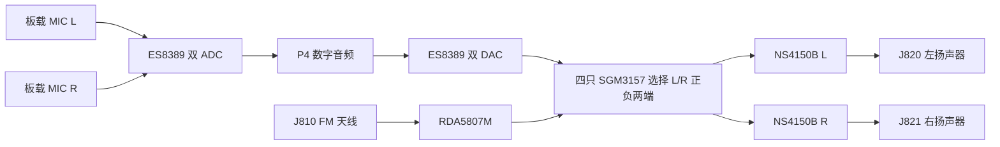

# 修订 H：板载 FM、双麦克风和双扬声器

2026-09-23。原设计只有外接 RDA5807M 模块接口、单声道合成及功放输入预留，载板没有 FM 接收芯片和扬声器功放。本次已在原理图及 PCB 上加入板载 RDA5807M，并按 [ESP32-S31-Korvo-1 V1.1 官方原理图第 4 页](https://dl.espressif.com/schematics/esp32-s31-korvo-1-schematics.pdf) 的 ES8389、双模拟 MEMS、双 NS4150B 结构改造。**主控仍为 OSPTEK P4C5/P4C6；仅参考 S31 的音频结构。**

两颗麦克风按用户要求直接焊在载板 B 面，取消 J800 外接咪头口。四张音频页为 `11_codec`、`12_fm_audio`、`18_dual_mic`、`19_stereo_pa`。这是已连接网表的未布线工程，尚未完成声音、接收灵敏度、EMC 或固件验证。

## 信号与接口

| 器件 / 信号 | 当前实现 | 约束 |
| --- | --- | --- |
| U800 ES8389 | 双 ADC + 双 DAC，独立 AUDIO_3V3 LDO | 不是 ES8311 的同封装替代件；所有 25 个焊盘已重建核对 |
| U802/U803 | LMA3729T381-OY3S，同型号、同朝向、顶进音 MEMS | 中心距 60 mm；顶声孔朝后壳，两条独立密封声道，不再使用咪头线缆 |
| U815 RDA5807M | MSOP10 接收芯片、32.768 kHz 晶体、3.0 V 可关断电源、I²C 隔离 | FM 左右声道独立，不合成单声道；接收频段/去加重由地区配置确定 |
| J810 | 1=FM 天线，2=GND；PH 2P，100 pF 隔直 + 低电容 ESD | 已替换旧 8P 模块接口，旧线束不能沿用；需独立 FM 天线及接收测试 |
| U811～U814 | SGM3157 ×4，两个声道各切换两条模拟线 | SOURCE=0 选 DAC；SOURCE=1 选 FM；上电默认 DAC |
| U820/U821 | NS4150B ×2，共用 AMP_EN | 两个独立 BTL，100 kΩ 输入电阻，标称增益 2.4 倍 / 7.6 dB |
| J820/J821 | 分别接左/右 4 Ω 扬声器；1=BTL+、2=BTL− | 任何一端都不能接地，不能并接左右输出；建议扬声器额定功率至少 3 W，机械型号待锁定 |

FM 与 DAC 的模拟信号分别隔直并偏置到 AUDIO_MID≈1.65 V 后进入选择器。每只功放输入再次隔直，保持其自身输入偏置。RDA 的 FM 输出只进入功放路径，**没有进入 Codec ADC 的 FM 回声参考通道**；两个 ADC 均用于麦克风。

## 电源与地址

ES8389 的默认 7 位地址 0x10 会与 FM 重叠。本板 R805 将 AD0 拉低，R806 将复用在 ASDOUT 的 AD1 拉高，选用 **7 位地址 0x12**；使用乐鑫 `esp_codec_dev` 以 8 位写地址配置时为 **0x24**，不能直接填 0x12。系统总线保留 RDA 的 0x10/0x11，BQ25896=0x6A、OPT3001=0x45、SHT40=0x44。上电还需回读身份并验证地址采样。

FM 使用 AP2112K-3.0，避免 3.3 V 稳压器正公差超过 RDA 3.3 V 上限；本地 I²C 上拉和 MOS 隔离随 FM_3V0 掉电。晶体候选 ABS07-32.768KHZ-7-T（CL=7 pF），按 RDA 单端 DCXO 接 RCLK 与地，不套用 MCU 双脚晶体电容电路。候选晶体的起振裕量、频偏和低温启动仍需实测。

双功放由 TLV62585 从主 +5V 单独降压供电：698 kΩ / 100 kΩ、0.1% 电阻，标称 **4.788 V**。按基准 ±2% 和电阻公差计算静态范围 **4.6840～4.8923 V**，低于 NS4150B 推荐 5.0 V 上限；纹波、启动过冲及压差影响不包含在此计算中。1 µH 电感额定要求 Isat≥4.5 A，正式料号及偏压后的有效 MLCC 容量仍需采购和电源验证。

NS4150B 资料在 5 V、4 Ω 下给出约 2 W / 1% THD+N、2.8 W / 10% THD+N；本板供电略低，不能宣称每路 3 W 无失真或 5 W。双声道、背光与蜂窝同时工作的电池/主升压预算、限幅和温升需联合测试。

## PCB 和外壳

坐标从 PCB 左上角按屏幕正视投影计，KiCad 原点另加 (50,50) mm。B 面背视时左右镜像，L/R 是电气通道名称。

| 位号 | PCB 中心 X,Y / mm | 面 |
| --- | --- | --- |
| U800 Codec | 22,65 | B |
| U802 MIC L | 20,73 | B |
| U803 MIC R | 80,73 | B |
| U815 FM | 41,66 | B |
| J810 FM 天线 | 52,74 | B |
| U820 / U821 功放 | 92,67 / 107,67 | F |
| J820 / J821 扬声器 | 94,73 / 109,73 | F |
| U822 / L820 功放电源 | 101,59 / 106,59 | F |

保留 251 个非音频封装的完整 PCB 对象、板框/孔、FPC 规则区及温湿度隔热槽。触摸 7.5 mm、LCD 46.1 mm 尖端约束及座位置保持修订 G。功放和扬声器插座在朝屏 F 面，处于排线禁布区之外；连接器高度及配线弯折还需纳入屏板间距，不能只看二维间距。

麦克风本体 2.95×3.76×1.0 mm，顶声孔约 Ø0.325 mm，封装局部坐标 (+0.005,−0.75) mm；翻到 B 面后需按 CAD 变换定位后壳孔。3D 是尺寸参考模型，不是供应商精密 CAD。壳体声道密封、两麦一致性及扬声器声腔隔离尚未验收。禁止覆盖声孔或采用不符合 MEMS 资料的清洗工艺。

布线时两路麦克风小信号成对走线，负端的地参考从对应麦克风附近引回 AC 耦合电容，保持连续地平面；不能与功放回流、降压开关节点共用细长回流路径。FM 天线和晶体远离数字时钟，功放输出成对并与麦克风线分隔。当前没有完成这些铜线。

## 固件迁移约定

现有 `display_board/main/audio_device.c` 仍按 ES8311、一个麦克风加 DAC 参考实现；本次没有将其标作可用于新硬件，也没有编译/上机验证新音频驱动。

| P4 GPIO | 网络 | ES8389 / 控制连接 |
| --- | --- | --- |
| 9 | I2S_DOUT | 经 R803 到 ES8389 pin4 MCLK/TDMIN，实际作为播放数据 |
| 10 | I2S_LRCK | 经 R802 到 pin10 LRCK |
| 11 | I2S_DIN | 经 R804 从 pin11 ASDOUT/AD1 接收双麦数据 |
| 12 | I2S_BCLK | 经 R801 到 pin8 SCLK |
| 13 | I2S_MCLK | 经 R800 到 pin9 DSDIN/CLKIN，实际作为主时钟 |
| 32 / 33 | SYSTEM_I2C_SDA/SCL | Codec 控制总线，7 位 0x12 |
| 48 | AMP_EN | 两只 NS4150B CTRL；低静音，上电各有 10 kΩ 下拉 |
| 51 | FM_POWER_EN | FM 3.0 V LDO 使能；默认低 |
| 52 | AUDIO_SOURCE_SELECT | 低 DAC / 高 FM；不能在有声时直接切换 |

pin4/pin9 的时钟/数据复用沿用 S31 官方接法，必须配置 ES8389 的 TDM/引脚复用、采样时钟与有效槽位；不能只把 ES8311 构造函数名替换。BSP、I²S 收发格式、双麦通道顺序和语音 AFE 都要同步适配，不能继续把第二个麦克风通道当回声参考。

切音源与关 FM 的顺序：拉低 AMP_EN → 静音数字输出或 FM → 切换 SOURCE / 电源 → 等待相应电源、偏置和时钟稳定 → 从低音量恢复功放。稳定时间应由芯片时序及样机爆音测试确定。FM 播放期间的语音打断/AEC 需要额外方案；本次硬件不保证 FM 全双工回声消除。

## 资料与验证

- [S31-Korvo-1 用户指南](https://docs.espressif.com/projects/esp-dev-kits/en/latest/esp32s31/esp32-s31-korvo-1/user_guide.html)及上述官方 V1.1 原理图。
- [ES8389 厂商完整手册公开镜像](https://atta.szlcsc.com/upload/public/pdf/source/20250902/D83DF6C36B2B03B18C523F480A71BD56.pdf)，Rev 1 / April 2024：引脚、地址、应用和 QFN24 图；[乐鑫驱动配置](https://github.com/espressif/esp-adf/blob/master/components/esp_codec_dev/device/include/es8389_codec.h)。
- [LMA3729T381-OY3S 厂商资料](https://atta.szlcsc.com/upload/public/pdf/source/20240604/C1447F1D03265B3E9B89676302ED84F3.pdf)，第 5～6 页封装与焊盘；[NS4150B 厂商手册镜像](https://www.micros.com.pl/mediaserver/ULNS4150b_NSIWAY_0001.pdf)。
- 用户本地 `docs/RDA5807M datasheet_v1.pdf`，第 2 / 17 / 18 页引脚、应用和封装；[ABS07](https://abracon.com/Resonators/ABS07.pdf)、[PESD5V0U1BA](https://assets.nexperia.com/documents/data-sheet/PESD5V0U1BA.pdf)。
- [SGM3157](https://www.sg-micro.com/rect/assets/a22623ad-a59a-4732-b010-4b667f6b9a7c/SGM3157.pdf)、[TLV62585](https://www.ti.com/lit/ds/symlink/tlv62585.pdf)。

原生 KiCad 10.0.5 检查：0 电气错误、13 个既有接口警告（原 AMP_EN 警告已关闭）、0 物理 DRC 违规、0 SCH/PCB 差异。另有 **845 项未连接、0 走线**。音频引脚/地址电阻/左右通道/BTL 极性/两麦间距由独立网表检查覆盖，326 个实体器件的模型均可加载。详见 `VERIFICATION.json`、`AUDIO_REVIEW.json` 和 `MODEL_VERIFICATION.json`。这些结果只验收本轮图纸与初摆，不能据此投板。
