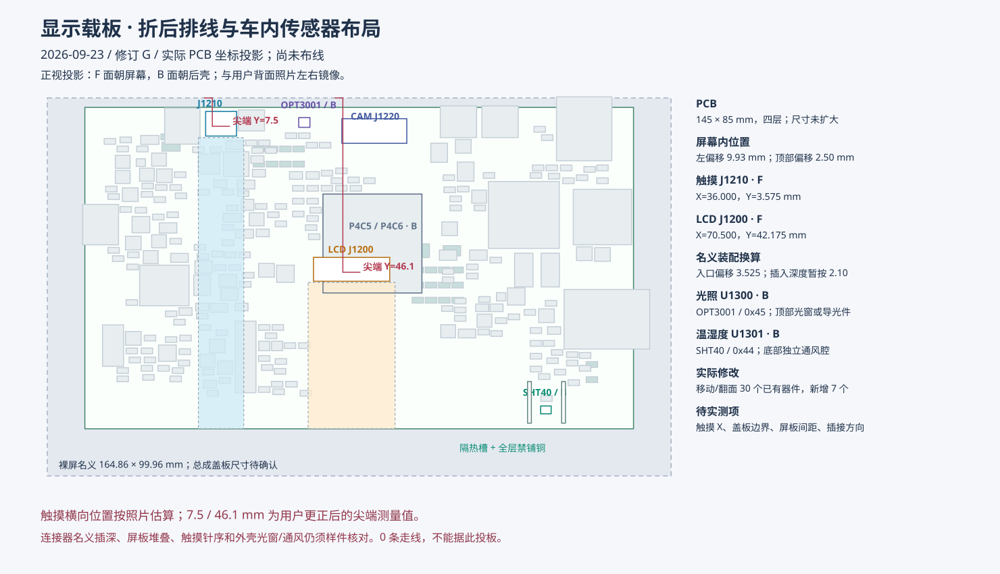

# LCD 排线与插座装配核对

日期：2026-09-19，修订 D。对象：LCM-070WS209-A0 与 OSPTEK 核心板新底板。用户已确认：**屏尾出厂就折到屏幕后面，应保持原折法，按折后位置布置插座。** 用户尚未测量，允许先留装配余量。修订 F 已加入实际 PCB 和 XUNPU 双接触系列 FPC 座，当前使用初摆坐标；屏板堆叠和折后实物尺寸仍缺，仍不能判定装配通过。详见 [当前接口实现](FPC_INTERFACES.md)。下文 FH12A 是历史对照，不是当前装配料号。

## 1. 规格书能确定的尺寸

依据用户提供的 [LCM 规格书](../../../docs/LCM-070--A0%20规格书.pdf) 第 5 页，统一采用**屏幕正视图，左上角为原点，向右为 X、向下为 Y**。背面观察时左右镜像，不能直接复用 X 坐标。

| 项目 | 图纸标注 / 换算 | 说明 |
| --- | --- | --- |
| LCM 外形 | 164.86 ±0.3 × 99.96 ±0.3 mm | 不含未知触摸盖板尺寸；第 4 页文字宽度有出入，暂按机械图 |
| 屏尾插接端左边 | X = (72.68) mm | 箭头指左边缘，不是中心；括号为参考尺寸 |
| 屏尾插接端宽 | 15.50 ±0.1 mm | 中心名义 X = 72.68 + 15.50/2 = **80.43 mm** |
| 端子 | 30 针，间距 0.50 ±0.05 mm | 首末触点中心跨度 14.50 ±0.05 mm |
| 触点宽 | 0.30 ±0.03 mm | 需要与插座允许的导体尺寸一起比对 |
| 插接端总厚 | 0.30 ±0.05 mm | 不等同于整个柔性区的厚度 |
| 露铜长度 | 3.50 ±0.3 mm | 最小 3.20 mm，不可当成“至少 3.50 mm” |
| 端部补强区 | 4.80 ±0.3 mm | 最小 4.50 mm；补强片自身厚度未给出 |
| 屏下边至展开尾端 | (56.54) mm | 参考展开尺寸，不是保证可弯长度；也不是公差下限 |
| 尾端两面 | 正视图为 PI 补强面，背视图为露铜面 | 背视图露铜面左端是 1 脚，右端是 30 脚 |

145 × 85 mm PCB 若与 LCM 居中，左、上偏移分别为 9.93、7.48 mm。LCD 插接中心应先按 **PCB 左边向右 70.50 mm** 对齐；若从 PCB 后面看，名义坐标是 74.50 mm。原修订 C 示意块中心换算为屏 X=77.63 mm，相差 2.80 mm。本次把示意块横向对齐，但这些数值仍不是已冻结的生产坐标，参考尺寸缺少位置公差。

## 2. 纵向距离：按出厂折后位置确定

原图中 LCD 功能块下沿距屏下边约 **13.88 mm**。功能块并非真实封装，该值只用于识别布局风险，不能冒充真实连接器插入口位置。

**不能根据 (56.54) mm 展开尺寸，要求用户重新折一条 U 形路径。** 它不等于出厂预折后露在背面的可插接长度，也不说明尾端在自然状态下距离屏下边多少。禁止为迁就插座而展开原折痕、拉扯根部绑定区或压出新的死折。

对已经朝屏内折回、由下向上插入的尾端，定义：

- `E`：在计划插接高度、无拉力状态下，**金手指最末端**到屏下边的垂直投影距离，不是补强片起点到屏下边；
- `I`：具体插座规定的插入深度，由入口量到插到底的尾端，不能把露铜长度直接当成此值；
- `d = E - I`：插座入口距屏下边的投影距离；
- `Y入口 = 99.96 - d - 7.48 = 92.48 - E + I`：相对居中 PCB 上边的名义坐标；
- `X插接中心 = 70.50 mm`：屏正视投影下相对 PCB 左边的名义坐标，出厂折法如果造成横向偏移也应随实物修正。

例如**仅作为换算示例**，若实测 `E=35 mm`、选定插座 `I=3.5 mm`，则入口距屏下边 `d=31.5 mm`，相对 PCB 上边 `Y=60.98 mm`。35 和 3.5 都不是本屏/插座已确认的实测值，不能写入生产封装。原示意 `d≈13.88 mm` 若配 `I=3.5 mm`，对应 `E≈17.38 mm`；只有实物在装配高度下满足这个位置，它才可能合适。

背面平放时量得的 E 可用于第一步选位置；抬高到插接平面后，弯曲段会消耗长度、尾端投影可能改变，最后还要在计划屏板间距下测一次。PDF 未标出出厂折线和折后包络，因此不能靠平面距离单独证明装配通过。

本次保留 LCD 朝屏面、横向、入口朝下的规划；**撤销纵向位置已确定的假设**。F 面中央至下部先预留屏尾通道和连接器调整空间，具体 Y 位置随折后末端位置、插接高度、实际插入深度一起冻结。触摸座同向，但不要求两座排在同一条水平线上；该 PDF 没有触摸排线尺寸，触摸距离仍未验证。

按用户“先留余量”的要求，规划 **F 面约 30 × 40 mm** 的插座、锁扣和屏尾空间，名义区域为 PCB 正视投影 `X=55.5～85.5 mm、Y=40～80 mm`，并保留向屏下沿延伸的排线路径。此区避开高器件、螺柱、底座和锐边；B 面器件仍需按真实封装检查焊盘/过孔和高度。这里是**布线前的摆放调整范围**，不是可滑动的插座，也不是已证明足够的长度公差。获得实物尺寸后可在预留区内定点；若自然屏尾落在区外，应调整布局，不能强拉排线。

## 3. 插座不能只看 30 针、0.5 mm

本轮用 [Hirose FH12A-30S-0.5SH(55)](https://www.hirose.com/en/product/p/CL0586-0556-5-55) 作上接触连接器的尺寸对照，**没有把它锁为采购或封装料号**。按厂家 [FH12 目录](https://www.hirose.com/en/product/document?clcode=CL0586-0556-5-55&documentid=D31648_en&documenttype=Catalog&lang=en&productname=FH12A-30S-0.5SH%2855%29&series=FH12) 第 6、10、17 页：

| 核对项 | 结果 |
| --- | --- |
| 针数、节距、插接厚度 | 名义相符：30、0.5 mm、0.30 ±0.05 mm |
| 露铜长度 | 连接器推荐至少 3.5 mm；屏尾最小 3.2 mm，**公差覆盖不完整** |
| 屏尾宽度 | 连接器推荐 15.5 ±0.07 mm；屏图 ±0.1 mm，**公差覆盖不完整** |
| 导体宽度 | 目录对 FPC 推荐 0.35 ±0.03 mm，对 FFC 为 0.30 ±0.03 mm；本屏 FPC 标 0.30 ±0.03 mm，不能直接认定满足其 FPC 推荐图 |
| 补强 | 推荐长度至少 4.5 mm，与屏图最小值相符；补强片自身厚度仍需确认 |
| 接触面 | 若只有无扭转的 180°折回，推导应为上接触型；但用户只确认出厂已预折，未确认实际露铜方向，不能据此锁型 |

这些是“尚未证明匹配”的差异，不能据此说所有同规格座都插不上。下一步应选能覆盖本屏全部公差的国内可采购插座，或取得屏厂指定的配套料号及认可尺寸。**普通下接触 FH12 与上接触 FH12A 不能无检查互换。** 折回后还需逐针对应屏尾与连接器；不能因为都编号 1～30 就默认同序。

## 4. 装配冻结条件

1. 保持出厂折法，确认折后金手指末端位置、露铜方向、可自由抬起的尾段及根部保护要求；屏厂给配套座料号时优先核对它。触摸排线另取得尺寸图。
2. 用实际插座图确定入口、插入深度、锁扣开闭高度、接触面与 1 脚映射，建立同一坐标系的侧视图。
3. 外壳中同时预留出厂折回包络、锁扣和装配工具空间；螺柱、底座、尖锐板边不能压到排线。屏板间距由侧视堆叠决定，不强行把尾端从金属背板拉到过高的插接平面。
4. 在 SCH/PCB 高速线冻结前，先做屏幕＋带真实插座的定位样板干装：完全插入且锁扣闭合、排线自然弯曲、无斜拉、合壳不受压。样板通过前不标“距离已验证”。

当前结论：**横向基准已校正；端子基本规格已读出；纵向折回、插座完整公差和实物合壳仍待闭合。**
