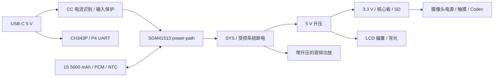
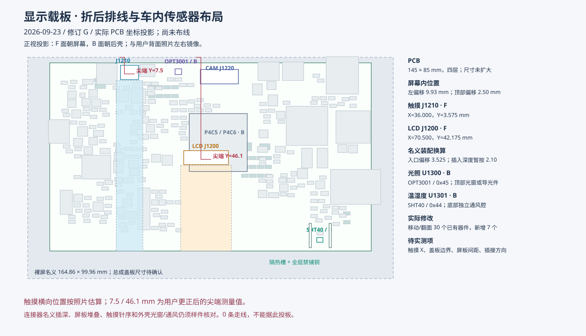

# OSPTEK P4C5 / P4C6 显示底板规划

日期：2026-09-19。状态：**方案阶段，未建立新 SCH/PCB，未布线、未做 ERC/DRC，也不是投板文件。**

按本轮要求放弃原裸 P4＋C6 单板方案，重新设计一块集成外围功能的底板。一个 25 × 25 mm、88 针邮票孔位置，择一贴装 OSPTEK ESP32-P4C5-Core 或 ESP32-P4C6-Core。兼容指同一 PCB 的两种装配配置，不是两个核心板同时装，也不是可热插拔的插座。

旧 `../display-singleboard/` 仅作历史记录，不作为新板的布局、电源或布线起点。本轮交付是本方案、[88 针核对表](CORE_PIN_COMPATIBILITY.csv)、[GPIO 分配](GPIO_PLAN.csv)、[布局示意](FLOORPLAN.svg) 和 [资料版本记录](SOURCE_AUDIT.json)。

## 1. 核心板兼容性

已对照本机两款核心板的 88 针表、内部连接图、尺寸图，以及底板使用指南 2026.09.10 中的 V1.5 原理图。

| 项目 | 核对结果 / 设计决定 |
| --- | --- |
| 封装 | 两份图均为 25 × 25 mm、每边 22 针、1.0 mm 节距；C6 图片外形公差标 ±0.3 mm，按较大公差留装配余量。实际焊盘、钢网及中央区域按两份 PcbLib/STEP 再重叠核对后建库 |
| 电源 | 核心板 85/86 脚输入 3.3 V；84 脚 RTC_VBAT 接受控 3.3 V，不能悬空或直接接满电 4.2 V 电池；66 脚是 LDO 输出，不能当电源输入 |
| 共用外围 | P4 GPIO、DSI、CSI、USB 专用信号在两款 88 针表中对应一致；全部产品外设只接 P4 |
| 差异脚 | 6～11 脚分别为 C5 GPIO28/27/26/25/24/23 与 C6 GPIO15/14/13/9/8/7，不接通用外设 |
| 无线下载 | 共用 UART：4=RF_RX、5=RF_TX；RF_BOOT 用互斥 0 Ω 电阻选择 C5 的 6 脚或 C6 的 9 脚。C5 下载还需 7 脚 GPIO27 高；C6 下载需 10 脚 GPIO8 高，先核对模组已有上拉再决定底板配置 |
| 内部占用 | P4 GPIO14～19 为内部无线 SDIO，GPIO6 接无线 GPIO2，GPIO54 控制无线 EN；都不能再分给底板功能 |
| P4 启动 | 外加 CHIP_PU 复位 RC；GPIO35 接 BOOT，GPIO36 保持下载要求的高电平。GPIO34～38 不挂会影响启动采样的负载 |
| 无线天线 | 复用核心板 IPEX-1，采用厂商双频 FPC 天线，布置于后壳塑料区、避开屏幕金属背板和电池；C6 仅用其 2.4 GHz 频段。核心板 RF 焊盘不再接一条并联天线支路 |
| 软件 | 仓库 C5 产品描述为 P4 v3.x、C6 为 v1.3；采购批次需读芯片版本。P4 v1.x/v3.x 必须分别编译固件，C5/C6 的 ESP-Hosted 从机固件也分别管理。IDF 5.5 系列至少采用支持实际芯片的补丁版，v3.x 最低 5.5.3；若使用 v3.2 外部 32 kHz 晶体则按官方告知要求 5.5.5+ |

P4C6 可作成本配置，P4C5 可作双频 Wi-Fi 配置；不按目录名称推定今后批次的 P4 硅版本。

无线维修下载时需要使 P4 保持复位、GPIO54 不驱动无线 EN，再由夹具控制 RF_EN/BOOT/UART，防止并联输出争用。底板只留内部维修点；日常 P4 下载使用外部 USB-C。

OBD 通信按自研 BLE 节点规划。C5/C6 的蓝牙能力是 Bluetooth LE，不能把经典蓝牙 SPP 型 ELM327 视作可直接连接的设备；若仍要兼容该类 ELM327，需要额外的经典蓝牙桥接硬件。本版先不增加桥接器，避免扩大成本和无线调试范围。[C5 官方能力](https://www.espressif.com/en/products/socs/esp32-c5)、[C6 官方能力](https://www.espressif.com/en/products/socs/esp32-c6)。

## 2. 功能和器件选择

以下是候选器件和接口方向，尚不是已核价或已锁库存的量产 BOM。优先沿用供应商公开且可购买的型号；不要以淘宝存在同名商品代替正品、版本和持续供货确认。

| 功能 | 首版规划 | 选型与限制 |
| --- | --- | --- |
| 核心 | OSPTEK P4C5-Core / P4C6-Core | 同一封装、两套配置电阻/BOM；官方淘宝店为鱼鹰光电工厂店 |
| LCD | LCM-070WS209-A0，7 寸 1024 × 600，JD9165BA | 专用 30P、0.5 mm FPC；按用户 PDF 针序重新绘制，不能复制 OSPTEK YDP400BT001-V4 的 30P 屏口 |
| 触摸 | 独立可选的 I2C 触摸接口 | 预留 6 信号：3.3 V、GND、SDA、SCL、INT、RST；FPC 脚序和上下接触以触摸总成图定。无触摸款不装触摸线和相关料即可，固件探测不到触摸时正常进入显示模式 |
| 摄像头 | OSPTEK ESP32-P4-Camera / SC2336，2 MP | 一个 24P、0.5 mm CSI 接口；按其原生 24P 定义，提供 2.8/1.8/1.5 V、电平转换及 24 MHz 时钟，不并联第二个 CSI 座 |
| 音频 Codec | ES8311 | I2S＋I2C，保持麦克风采集和网络音频播放；模拟电源单独低噪声供电 |
| 外接麦克风 | LinkMems **LMA3729T421-OA1**，C5373235 | 装到外壳上的小麦克风头板，经线缆接主板；它是裸 MEMS 器件，不是可直接焊线的咪头。主板 4P 锁扣座提供清洁电源、MIC_P、MIC_N/回流、GND，线长先限 100 mm，声孔加密封圈 |
| 外接喇叭 | FUET **FS40DS0450-H18.3**，C782108 | 国内分销可检索的 4 Ω、额定 5 W、约 40 mm 扬声器候选，固定在后壳独立声腔，线接 JST-PH 2P；高度约 18.3 mm 会影响壳厚，最终以供应商机械图为准 |
| 功放 | 纳芯威 **NS4814**，集成升压的模拟功放候选 | 从 SYS 供电，目标 4 Ω、3 W 持续语音 / 5 W 短时峰值输出；在最低电池电压、THD+N、温升实测后锁上限。5 W 喇叭额定值不等于功放在任何电池电压下都能输出 5 W |
| FM | **RDA5807M 接收模块**接口 | 8P 有锁线对板接口：3.3 V、GND、SDA、SCL、L、R、GND、保留；模块自带晶体、另接 FM 天线。FM L/R 经电阻合成单声道、隔直/偏置后，经双路模拟开关切换至功放，不直接短接 L/R，也不和 DAC 输出硬并联 |
| 音源切换 | SGM3157 × 2 或同级双通道音频开关 | 切换 Codec 与 FM 的差分输入路径，模拟电压必须保持在开关电源范围内；播语音提示时静音 FM 并切换至 Codec，麦克风 ADC 保持独立 |
| USB-UART | **CH343P**＋自动下载电路 | 唯一外部 USB-C 同时充电、日志、P4 烧录；D+/D−只进入 UART 桥。无线芯片另外留内部维修烧录触点，避免为日常用户增加选择拨码 |
| microSD | 带检测脚的自弹 TF 卡座，4 bit SDMMC | 3.3 V 可关断供电、ESD、防反灌；首版按 3.3 V 模式验证，不默认支持 1.8 V UHS |
| 电池充电 | 圣邦 **SGM41513**，无 A/D 后缀 | I2C、NVDC power-path、NTC、反灌管理；选择不占 USB 数据线的 PSEL 版本；与 A/D 的焊盘功能不同，不在 BOM 中当成直接替换料 |
| USB 电流识别 | **TUSB320LAI**，固定 Sink | 识别 Type-C 对端声明的默认/1.5 A/3 A；5.1 kΩ 电阻本身不代表可取 3 A。供电来自 VBUS 的常开小电源域，避免没电时识别死锁 |
| 主电源 | **TPS61088**→5 V；**TLV62569**→3.3 V | 5 V 主路目标 2 A，3.3 V 主路目标 2 A；降额和封闭壳温升验证后定。TI 器件作为国内可采购的首版候选，不强行用未验证的同名国产替代 |
| LCD 偏置 | **TPS65150** 候选，另加 1.8 V LDO | 可调 AVDD/VGH/VGL 和 VCOM 缓冲、可设置启动延时；需针对屏幕实际电流和断电放电顺序验算后选定，不沿用旧板齐纳钳位做法 |
| 背光 | **SY7200** 恒流升压候选 | 3 串 9 并，180 mA 总电流，LED 8.1～9.9 V；PWM 调光、开路保护、关机断电；电感/采样电阻额定值按计算选择 |
| 电量与温度 | 电量计接口/候选 CW2015＋板温 NTC | 电量计需对应电池模型，型号及供货再锁；板温与电池温度分别测量，不能用单个电压值宣称准确电量 |
| 按键 | RST、BOOT 侧按；电源侧滑 | 通过壳体侧孔/导向柱可操作；电源外部拨帽建议 10～14 mm，行程按实物开关定义，开关只承载控制电流 |

普通电阻和低压小电容优先 **0603（公制 1608）**。大容量 MLCC 按直流偏压后的有效电容选 0805/1206；背光、电源电感按饱和电流选屏蔽功率封装，不用 0603 信号电感替代。芯片近端器件只有在参考设计和寄生参数确有要求时采用 0402。

## 3. 屏幕适配必须先闭合的事项

LCM PDF 给出 VDD/VDDIO 1.8 V、AVDD 9.8 V、VGH 18～20 V、VGL −8.5～−7.5 V、VCOM 典型 3.3 V。RESET、STBYB、方向脚均在 1.8 V 域，不能直拉 3.3 V。VCOM 用缓冲驱动并留校准值，不把无源分压视作已经验证的面板驱动。

STBYB、RESET、逻辑电源、偏置使能、背光各有独立控制及安全默认状态。按 PDF 第 8～9 页实施启动/关机，包括偏置电源之间的延时和掉电约 100 ms 的保持窗口；硬件电源开关转为关机请求，保留受控关机时间，不能直接在面板工作时切掉所有电源。

**不能将当前 PDF 等同于“两 lane 已确认”。** 它列出 D0～D3 和 100～500 Mbps，而核心板只引出两条数据 lane。1024 × 600 × 60 × 24 / 2 = **442.368 Mbps/lane**（仅有效像素）；典型总周期 1344 × 635 × 60 × 24 / 2 = **614.477 Mbps/lane**（粗略含消隐预算，未加协议开销）。因此不能直接保证典型时序、RGB888、60 Hz、两 lane、500 Mbps 同时成立。需要厂商两 lane 初始化表及允许的视频模式/porch；可讨论更小消隐、RGB565 或受支持的帧率，但必须是面板允许的配置，不能擅自降帧规避规格。先用官方 P4 验证板和正确面板供电验证后再锁高速布线。

本屏裸 LCM 机械图为 164.86 × 99.96 × 2.8 mm，第 4 页文字宽度存在 1 mm 出入，以第 5 页图做规划并待确认。底边 FPC 56.54 mm 是图示尺寸，不能直接当成扣除弯折和连接器插入量后的可用线长。新板把入口放在朝屏面，取消旧板需绕行约 61.7 mm 的路径。

触摸款与非触摸款要求共用 **同一 LCD 电气版本**；此处不是任意 7 寸屏通用板。用户先前提供的 LCD PDF 没有触摸盖板外形、触摸 FPC 针序或控制器型号，GT911 只能作为驱动候选，不能据此定触摸座。当前按 MIPI 单接口收敛；新需求没有要求 RGB 并口，不预先增加并联高速接口。

该屏的工作温度标为 −10～60 ℃、典型亮度 300 cd/m²。它可作为当前样机目标，不能据此标称整机宽温车规或强日光可读。

## 4. 电池、充电和关机

- 电池先按 **1S、3.7 V、5000 mAh（18.5 Wh）** 规划。采购要求含 PCM、10 kΩ NTC，允许至少 6 A 连续放电；优先找 8 A 以上保护/引线能力留余量。软包外形先预留约 95 × 65 × 10 mm 的独立仓，这是空间预算，不是假定某个“尺寸型号”必有 5000 mAh。
- 主板电池口改为带锁、额定至少 6 A 的连接器，例如 JST-VH 电源 2P，另设防误插 NTC 2P；正式料号需按线径/温升降额。**不使用普通 PH2.0 2 A 插座承载整机电池电流**。保险、MOSFET、铜皮、过孔和线束按同一峰值电流预算设计。
- 正常显示/无线/适度音量以 6～8 W 为初始预算，高亮＋摄像＋大音量按最高约 15 W 短时预算。以 18.5 Wh × 80% 可用能量估算：6～8 W 约 1.9～2.5 h，15 W 约 1 h；均为估算，温升、老化和实际亮度会改变结果。
- SGM41513 数据手册规定电池连续放电上限 6 A；按 3.2 V、综合效率 85%、15 W 算约 5.5 A，裕量不大。设计加入欠压/大音量降额，并验证最差温度下电源路径；不能将 6 A 绝对边界用作无限持续设计目标。
- 首版充电目标 1～1.5 A，主负载优先，USB 功率不足时自动降低/暂停充电；供电弱时降低亮度和功放峰值。电脑 USB 数据口不保证可供整机最大负载和充电同时进行。
- Type-C 固定受电端，不加 USB-OTG 母口；CC 声明、USB 枚举允许电流、VBUS 压降共同限制输入。旧 A-to-C 或未完成枚举时采用保守电流和低功耗启动，电池可补峰；无电池且弱电源时不承诺全功能启动。充电器 PSEL 默认值、首次上电输入门控和 MCU 尚未运行时的行为必须在 SCH 阶段核定。
- 电源侧滑开关触发受控关机：静音→停止写 SD→LCD 关机时序→切断系统负载。保留 0.5～1 s 的硬件关断窗口，并有固件失效后的超时断电路径；USB 插入时关机充电仍可工作。
- 电池 NTC 直接进入充电 IC，不能只靠软件判温。初始充电温窗按 0～45 ℃，最终取电芯规格更严格者；屏幕、电池和功率器件各自的温度上限纳入保护。断电/运输电流目标从电池端测整机，不用芯片自身 µA 数代替整机结果。
- 电池靠后壳固定，与功率区、扬声器磁路分隔，预留软包装配/膨胀余量；不把车内长期暴晒视作已经满足的使用条件。

## 5. 全局布局和外壳约束

建议初始板框 **145 × 85 mm，四层 FR-4**，四角 M2.5 孔中心距边约 4 mm、孔周留支柱/螺钉禁布区。对比裸 LCM 外形，每侧平均余量约 9.93 mm（水平方向）和 7.48 mm（垂直方向）。尺寸依据是外围器件、0603 可维护性、散热和壳体余量，不是直接把屏幕尺寸照搬成 PCB；完整触摸盖板图到位后再冻结。

以屏幕正常横屏为准，F 面朝屏、B 面朝后盖。图是两面器件的功能投影，不是完成的元器件坐标或铜箔。

| 区域 | 位置规划 | 目的 |
| --- | --- | --- |
| 左边缘 | USB-C（充电/UART），CH343P 紧邻 | 壳侧插线，ESD 紧靠接口；USB 铜线短 |
| 左上/左中 B 面 | 充电器、SYS 开关、5 V 升压和 3.3 V 降压 | 输入到电池、主供电路径短；大电流不穿越音频/高速区域 |
| 中部 B 面 | P4C5/P4C6 核心板 | 按 DSI/CSI 同侧引脚方向统筹旋转，先确定两束 MIPI 出线走廊，再分配慢速信号；IPEX 线朝后壳天线区走 |
| 上边缘偏中 | 摄像头 FPC，长边横向、入口朝上 | 便于摄像头固定在外壳上沿，CSI 与电源区隔开 |
| 上边缘偏右 | 大拨帽电源侧滑开关、RST/BOOT 侧按 | 不从底座方向操作；复位孔凹入防误触，手指/工具可达 |
| 右边缘中部 | microSD 卡座，卡口向右 | 保证弹出行程和手指取卡空间，不能被螺柱挡住 |
| 右上/右中 B 面 | Codec、外接麦克风、FM 接口 | 模拟输入远离升压电感和扬声器大电流回流；麦克风与喇叭接口不共用线束 |
| 右下 B 面 | 功放及喇叭座 | 靠近后壳声腔；功放电源局部回流，线缆成对走线 |
| 中下 F 面 | LCD FPC，长边横向、入口朝下 | 屏尾直接折入朝屏面，入口预定在屏尾水平投影附近，按图示 72.68 mm 基准换算后再确认观察面；不强行放到板几何中心 |
| F 面靠左/右边 | 可选触摸 FPC | 按实际触摸尾方向选一侧，不因猜测同时并联两个触摸座 |
| 中下 B 面 | LCD 偏置/背光 | 靠近 LCD 座，避开 MIPI 走廊，升压热区不贴电池 |
| 底边内侧 | 少量维修触点/可选扩展焊盘 | 保留约 8 mm 底座禁放高件区；不设面向用户的插拔口 |

普通器件按功能组紧凑布置，利用背面分担面积；不为视觉上均匀而拉开去耦电容或开关电源回路。两大热源（充电/主升压与功放）分别位于左右，中央为高速走线走廊。

F 面只放低矮屏/触摸座及必要小器件，预留屏尾弯折、锁扣打开和工具空间；B 面放核心板及高件以利散热。前框承载屏幕，后壳四角支柱承载 PCB，前后壳卡扣定位＋螺钉锁定；电池和喇叭固定在后壳。先在后壳装板并插屏线，再合前框，不能要求合壳后伸手插 FPC。LCD 金属背板与 F 面器件有绝缘和高度间隙；天线避开金属屏蔽。

## 6. 电气布线约束

| 网络类别 | 规则和验收依据 |
| --- | --- |
| 叠层 | 先向板厂确认四层叠层与阻抗线宽/间距。L2 保持完整地；L1 优先 MIPI/关键时钟；L3 为电源和慢速；L4 局部器件/慢速。若底层高速线下方没有连续地，先调整参考层，不跨电源岛凑线 |
| DSI / CSI | 分别做 100 Ω ±10% 差分；对内差≤0.254 mm，同一接口各对差≤0.762 mm，作为底板设计上限；成对换层、相同过孔数、附近地回流过孔、无分叉/长测试点支线。DSI 与 CSI 两个独立链路不互相等长 |
| 核心板内部线长 | 外部等长不代表含核心板后的总路径等长；请厂商提供模组内部各对长度/偏差，纳入总预算。拿不到时明确只通过底板几何检查，必须做整链路实测 |
| MIPI 干扰 | 同对同距、连续参考地；时钟对周围地铜，同接口对间至少按乐鑫 2W 建议，距其他高速/开关噪声至少 3W；器件布局先给 MIPI 留通道，再布普通线 |
| USB-UART D+/D− | 按 90 Ω 差分、短且对称，建议对内差≤0.5 mm；这是板级设计目标，CH343P 为 Full-Speed USB，不与摄像头/显示差分线做跨总线等长 |
| SDMMC | 六信号同组短走、完整地参考；CLK 源端预留串阻、CMD/DAT 按规范上拉；具体 skew 和串阻按时钟及模块/卡座模型收敛，不套用 MIPI 的长度限值 |
| I2S / I2C | 时钟远离 MIC；I2C 分两组，摄像头电压域隔离；按总线电容选上拉，断电外设不能被信号反向供电 |
| 充电/升压 | 输入电容、开关、功率电感和输出电容组成小回路；SW 铜皮短小；反馈从输出电容 Kelvin 取样，避开 SW/电感；电池/SYS 用铜面和足额并联过孔 |
| 音频 | 麦克风小信号局部回流完整，功放差分输出成对；不切割公共地平面造回流断点。按线缆长度预留输出 EMI 滤波；任何喇叭端都不能接 GND |
| 量产门槛 | 原理图/PCB 网表一致，0 未连接，0 短路/间距/板边/孔铜错误；不通过关闭 DRC 项或忽略 ratsnest 达标。核对 3D/实物连接器、装配空间、电源温升、冷热启动和两核心板实测 |

## 7. 开始画 SCH/PCB 前的冻结顺序

1. **核心板封装和版本**：88 针功能已核对；下一步重叠校验两个 PcbLib/STEP，记录可装配批次和 C5/C6 配置电阻。
2. **屏幕闭环**：取得 JD9165BA 两 lane 初始化/合法时序、供电负载电流，以及触摸总成脚位和排线接触面；以官方 P4 板验证。此项影响能否使用这块屏，不等到 PCB 画完才问。
3. **机械冻结**：在 145 × 85 mm 草案上放实际连接器轮廓，核对 LCD/触摸弯折长度、四角螺柱、SD 弹出行程、USB 插头、开关拨帽、40 mm 喇叭和电池仓；外壳厚度由这些实物决定。
4. **电源与 BOM**：补全屏电源电流，校核充电器 6 A 路径、功放最低电压、热耗散和休眠反灌；取得首选/替代料的封装及在售来源。任何替代不是仅凭功能名换料。
5. **SCH**：按核心板、电源/充电、LCD/触摸、摄像头、音频/FM、USB/SD/维修六张功能页绘制；引脚矩阵和时序先审完，ERC 通过再转板。
6. **PCB**：连接器/孔位→核心板和高速走廊→电源/Codec 功能组→去耦→普通器件；先高电流和高速网，再低速，最后铺铜/热设计/丝印，完成 DRC 和装配审查后才导出制造文件。

本轮不创建空白 SCH/PCB 或自动布线文件。先把上述方案和供应商缺失资料落实，可以避免因错屏针序、无线引脚占用或电流不足重画底板。

## 8. 依据

- 本机 `C:/projects/osptek/esp32-p4c5-core-board/` 与 `esp32-p4c6-core-board/`：`pages/pin-definition_EN.md`、内部连接图、尺寸图、SchLib/PcbLib、核心板使用指南。
- 本机 `esp32-p4c5-module-dev-board/docs/ESP32-P4-Module_User Guide 20260910.pdf` 第 6 页：**V1.5 / 2026-08-28** 原理图；与文件夹内旧 V1.3 PDF 区分。厂家镜像：[C5 核心板](https://github.com/osptek/esp32-p4c5-core-board)、[C6 核心板](https://github.com/osptek/esp32-p4c6-core-board)。
- [用户 LCM 规格书](../../../docs/LCM-070--A0%20规格书.pdf)：第 5～10 页机械、电压、时序。
- [乐鑫 P4 布局规范](https://docs.espressif.com/projects/esp-hardware-design-guidelines/en/latest/esp32p4/pcb-layout-design-esp32p4.html)、[P4 v3.x 与固件兼容性](https://documentation.espressif.com/esp32-p4-chip-revision-v3.x_user_guide_en.html)、[v3.2 外部 32 kHz 兼容告知](https://documentation.espressif.com/AR2026-004_Compatibility_Advisory_for_ESP32-P4_Chip_Revision_v3.2_EN.html)。
- [C5 下载启动条件](https://docs.espressif.com/projects/esptool/en/latest/esp32c5/advanced-topics/boot-mode-selection.html)、[ESP32-P4 Function EV Board](https://docs.espressif.com/projects/esp-dev-kits/en/latest/esp32p4/esp32-p4-function-ev-board/user_guide.html)。
- [SGM41513](https://www.sg-micro.com/product/SGM41513)、[系列数据手册](https://www.sg-micro.com/rect/assets/58a4fe4d-da1d-49a3-b312-5664211d9016/SGM41513_SGM41513A_SGM41513D.pdf)、[TUSB320LAI](https://www.ti.com/product/TUSB320LAI)、[TPS61088](https://www.ti.com/product/TPS61088)、[TPS65150](https://www.ti.com/product/TPS65150)。
- [ES8311 厂商资料](https://www.everest-semi.com/pdf/ES8311%20PB.pdf)、[NS4814 厂商页面](https://www.nsiway.com.cn/list_37/94.html)、[SGM3157](https://www.sg-micro.com/product/SGM3157)、[麦克风采购型号](https://jlcpcb.com/partdetail/LMA3729T421-OA1/C5373235)、[喇叭采购型号](https://www.lcsc.com/de/product-detail/C782108.html)。
- [用户指定 UomiPi 参考设计](https://oshwhub.com/ikalyes/esp32p4c6)：页面直读返回 403，已读搜索索引中的接口说明；未把未取得的在线工程文件当作已审核电路。
