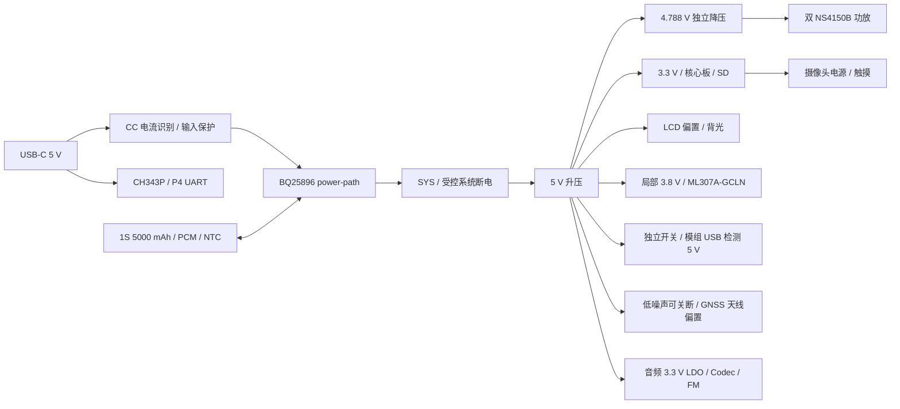

# OSPTEK P4C5 / P4C6 显示底板

2026-09-23，修订 K：**F 面朝后壳，B 面朝屏幕**。FPC 座、高 2Pin 接口及全部器件本体集中到 F 面，增加触摸 10×3 mm、LCD 20×3 mm 两处实际穿线槽。B 面无器件本体，但通孔脚仍名义露出最高约 2.4 mm，需绝缘间隙；槽位与穿板线长待实物确认。见 [正反面装配说明](SCREEN_BACK_ASSEMBLY.md)。

修订 J 保留：L400 改为国产长江微电 **FEXU0640S2R2MGS / C54140025**，2.2 µH，6.2×6.0×4.0 mm；SCH/PCB/3D 已同步。见 [电感选型与核算](INDUCTOR_SELECTION.md)。

修订 I 保留：SIM 改为 **GCT SIM8066 按压自锁 Nano-SIM**，从屏幕正视的右侧推入、再次按压弹出。原理图/PCB/3D 已同步；卡检测及上拉按 ML307A 手册修正。见 [SIM 卡座与外壳要求](SIM_SOCKET.md)。

修订 H 保留：新增板载 **RDA5807M**，音频改为 **ES8389 + 两颗直接焊载板的 MEMS 麦克风 + 两只 NS4150B / 两路扬声器接口**，参考 ESP32-S31-Korvo-1 官方结构；主控仍为 P4C5/P4C6。见 [音频架构与固件迁移](AUDIO_ARCHITECTURE.md)。

修订 G 的原始测量继续保留：总成顶部到原平面折后尖端 **触摸 7.5 mm / LCD 46.1 mm**。板框 145×85 mm，PCB 顶部偏移 2.50 mm。修订 K 将坐标改为屏幕背视，插座暂加 4 mm 穿板长度补偿，不能当作已确认的插接位置；光照/温湿度及隔热槽保留。见 [当前布局](FPC_FIT_REVIEW.md)、[传感器](CABIN_SENSORS.md)。

当前 20 页原理图、350 个电路封装＋4 安装孔，327 个实体器件均有可加载模型，默认装配 320 个；7 个互斥配置/射频调谐件保持 DNP。**未布线，848 项未连接，整机电路尚有既有缺口，不能投板。** ERC 0 error / 13 个既有 warning；原生物理 DRC、SCH/PCB 一致性 0 违规。检查边界见 [设计状态](DESIGN_STATUS.md)。

按本轮要求放弃原裸 P4＋C6 单板方案，重新设计一块集成外围功能的底板。一个 25 × 25 mm、88 针邮票孔位置，择一贴装 OSPTEK ESP32-P4C5-Core 或 ESP32-P4C6-Core。兼容指同一 PCB 的两种装配配置，不是两个核心板同时装，也不是可热插拔的插座。

旧 `../display-singleboard/` 仅作历史记录，不作为新板的布局、电源或布线起点。本轮新增 [KiCad 工程](display_carrier.kicad_pro)、[原理图](display_carrier.kicad_sch)、[PCB 初摆](display_carrier.kicad_pcb)、[电气核算](ELECTRICAL_REVIEW.md) 和 [装配配置](ASSEMBLY_VARIANTS.csv)。已有资料包括[88 针核对表](CORE_PIN_COMPATIBILITY.csv)、[GPIO 分配](GPIO_PLAN.csv)、[可选 4G/GNSS 设计](OPTIONAL_LTE_GNSS.md)、[ML307A-GCLN 接线规划](MODEM_PIN_PLAN.csv)、[布局示意](FLOORPLAN.svg) 和 [资料版本记录](SOURCE_AUDIT.json)。

修订 C 的主要决定：蜂窝模组改为 17.7 × 15.8 mm、94 脚 LGA 的 ML307A-GCLN；采用内部 USB RNDIS 网卡作为联网首选、UART0 独立控制；3.8 V 降压和至少 2 × 220 µF 储能靠近模组布置。GPIO24/25 改为 USB 检测电源和 GNSS 有源天线电源控制，不再保留这两脚的 USB-FS 维修用途。外部 CH343P USB-C 充电/串口下载、屏幕/触摸、摄像头、SD、音频/FM 和双核心板兼容规划继续保留。

## 1. 核心板兼容性

已对照本机两款核心板的 88 针表、内部连接图、尺寸图，以及底板使用指南 2026.09.10 中的 V1.5 原理图。

| 项目 | 核对结果 / 设计决定 |
| --- | --- |
| 封装 | 两份图均为 25 × 25 mm、每边 22 针、1.0 mm 节距；C6 图片外形公差标 ±0.3 mm，按较大公差留装配余量。已导入两份 PcbLib 核对 88 脚名义坐标；共用焊盘按 C5 非 EP 版调整，详见 FOOTPRINT_SOURCES.md。公差、钢网和实际焊接仍待验证 |
| 电源 | 核心板 85/86 脚输入 3.3 V；84 脚 RTC_VBAT 接受控 3.3 V，不能悬空或直接接满电 4.2 V 电池；66 脚是 LDO 输出，不能当电源输入 |
| 共用外围 | P4 GPIO、DSI、CSI、USB 专用信号在两款 88 针表中对应一致；全部产品外设只接 P4 |
| 差异脚 | 6～11 脚分别为 C5 GPIO28/27/26/25/24/23 与 C6 GPIO15/14/13/9/8/7，不接通用外设 |
| 无线下载 | 共用 UART：4=RF_RX、5=RF_TX；RF_BOOT 用互斥 0 Ω 电阻选择 C5 的 6 脚或 C6 的 9 脚。C5 下载还需 7 脚 GPIO27 高；C6 下载需 10 脚 GPIO8 高，先核对模组已有上拉再决定底板配置 |
| 内部占用 | P4 GPIO14～19 为内部无线 SDIO，GPIO6 接无线 GPIO2，GPIO54 控制无线 EN；都不能再分给底板功能 |
| P4 启动 | 外加 CHIP_PU 复位 RC；GPIO35 接 BOOT，GPIO36 保持下载要求的高电平。GPIO34～38 不挂会影响启动采样的负载 |
| 无线天线 | 复用核心板 IPEX-1，采用厂商双频 FPC 天线，布置于后壳塑料区、避开屏幕金属背板和电池；C6 仅用其 2.4 GHz 频段。核心板 RF 焊盘不再接一条并联天线支路 |
| 软件 | 仓库 C5 产品描述为 P4 v3.x、C6 为 v1.3；采购批次需读芯片版本。P4 v1.x/v3.x 必须分别编译固件，C5/C6 的 ESP-Hosted 从机固件也分别管理。IDF 5.5 系列至少采用支持实际芯片的补丁版，v3.x 最低 5.5.3；若使用 v3.2 外部 32 kHz 晶体则按官方告知要求 5.5.5+ |

P4C6 可作成本配置，P4C5 可作双频 Wi-Fi 配置；不按目录名称推定今后批次的 P4 硅版本。

无线维修下载时需要使 P4 保持复位、GPIO54 不驱动无线 EN，再由夹具控制 RF_EN/BOOT/UART，防止并联输出争用。底板只留内部维修点；日常 P4 下载使用外部 USB-C。

OBD 通信按自研 BLE 节点规划。C5/C6 的蓝牙能力是 Bluetooth LE，不能把经典蓝牙 SPP 型 ELM327 视作可直接连接的设备；若仍要兼容该类 ELM327，需要额外的经典蓝牙桥接硬件。本版先不增加桥接器，避免扩大成本和无线调试范围。[C5 官方能力](https://www.espressif.com/en/products/socs/esp32-c5)、[C6 官方能力](https://www.espressif.com/en/products/socs/esp32-c6)。

## 2. 功能和器件选择

以下是候选器件和接口方向，尚不是已核价或已锁库存的量产 BOM。优先沿用供应商公开且可购买的型号；不要以淘宝存在同名商品代替正品、版本和持续供货确认。

| 功能 | 首版规划 | 选型与限制 |
| --- | --- | --- |
| 核心 | OSPTEK P4C5-Core / P4C6-Core | 同一封装、两套配置电阻/BOM；官方淘宝店为鱼鹰光电工厂店 |
| LCD | LCM-070WS209-A0，7 寸 1024 × 600，JD9165BA | 专用 30P、0.5 mm FPC；按用户 PDF 针序重新绘制，不能复制 OSPTEK YDP400BT001-V4 的 30P 屏口 |
| 触摸 | 独立可选的 I2C 触摸接口 | 与 LCD 座同在朝屏面，横向放置、入口同朝下；按照片镜像估算 PCB X=36 mm，横向仍待实测。预留 3.3 V、GND、SDA、SCL、INT、RST；脚序和接触面待定。当前接口器件均装配；无触摸款不接触摸排线，固件正常进入显示模式 |
| 可选 4G＋定位 | 中移 **ML307A-GCLN**，型号已由用户选定 | 17.7 × 15.8 × 2.4 mm、LGA94；同板选装 GPS/北斗、Nano-SIM、LTE/GNSS 双天线、电源及电平转换。标准 AT 固件＋内部 USB RNDIS 优先；具体固件/描述符/GNSS 并发仍需样品验证，不能用 ML307R 或 A-D 系列代替 |
| 摄像头 | OSPTEK ESP32-P4-Camera / SC2336，2 MP | 一个 24P、0.5 mm CSI 接口；按其原生 24P 定义，预留 2.8/1.8 V、电平转换及 24 MHz 时钟；公开 24P 针序没有外接 1.5 V 脚，不向 NC 引脚供电，DVDD 来源待厂家确认。J1220 和 CSI 针序已绘制；摄像头电源、时钟和电平转换仍待完成 |
| 音频 Codec | ES8389，已绘制 | 双 ADC / 双 DAC；7 位 I²C 0x12；沿用 S31 TDM 引脚复用，旧 ES8311 固件需迁移 |
| 板载双麦克风 | LinkMems **LMA3729T381-OY3S ×2** | 直接焊在 F 面，60 mm 中心距；顶声孔朝后壳，取消外接咪头小板 |
| 双扬声器 | 两个独立 4 Ω 扬声器，额定 ≥3 W 为候选要求 | 分别接 J820/J821 PH 2P，BTL 两端均不能接地；声腔/外形和采购型号待确认 |
| 双功放 | **NS4150B ×2**，已绘制 | 独立 4.788 V 降压供电，共用 AMP_EN；目标及音量限制按 THD/温升实测，不沿用旧 5 W 输出目标 |
| FM | **板载 RDA5807M**，已绘制 | 3.0 V 可关断电源、32.768 kHz 晶体、I²C 隔离和 J810 天线口；左右声道独立；射频与起振待验证 |
| 音源切换 | SGM3157 ×4 | 分别切换左右声道正负两条模拟线；默认 DAC，切 FM 前先静音两只功放 |
| USB-UART | **CH343P**＋自动下载电路 | 唯一外部 USB-C 同时充电、日志、P4 烧录；D+/D−只进入 UART 桥。无线芯片另外留内部维修烧录触点，避免为日常用户增加选择拨码 |
| Nano-SIM | **GCT SIM8066-6-1-14-01-A** | 按压自锁、右侧插入、带常闭检测；当前厂家 Rev B 与实物壳体配合待核对，见 SIM_SOCKET.md |
| microSD | 带检测脚的自弹 TF 卡座，4 bit SDMMC | R0 已画 3.3 V 可关断供电和串阻；卡座 ESD 与断电 IO 防反灌尚未闭合。首版按 3.3 V 模式验证，不默认支持 1.8 V UHS |
| 电池充电 | **BQ25896**，替换原 SGM41513 候选 | NVDC、NTC、PSEL，不占用 USB 数据线；厂商给出最高 9 A 电池放电通路，按整机热设计降额。充电仍设 1～1.5 A；这里不是 9 A 充电。与旧候选不是焊盘直接替换 |
| USB 电流识别 | **TUSB320LAI**，固定 Sink | R0 用 GPIO 模式，仅使用“至少 1.5 A”信号，3 A 也保守按 1.5 A 档处理。TPS2553 限流最坏上限约 439 / 1253 mA；另计 USB 桥消耗。详见 ELECTRICAL_REVIEW.md |
| 主电源 | **TPS61088**→5 V；**TLV62569**→3.3 V | 5 V 主路改按 4 A 峰值目标及封闭壳热预算设计，3.3 V 主路目标 2 A；整机同时负载受功率预算约束。开关电流额定值不等于可持续输出电流 |
| 可选 4G 电源 | **TLV62585**：5 V→3.8 V，3 A 支路候选 | 放在右侧模组附近，按 GCLN 较新兼容手册的 **3.4～4.3 V** 约束，2 A 发射瞬态；至少 2 × 220 µF 近端储能，独立关断/主动放电/电流测点。USB 检测 5 V 和 GNSS 天线偏置单独可控，不直连 SYS |
| LCD 偏置 | **TPS65150** 候选，另加 1.8 V LDO | 可调 AVDD/VGH/VGL 和 VCOM 缓冲、可设置启动延时；需针对屏幕实际电流和断电放电顺序验算后选定，不沿用旧板齐纳钳位做法 |
| 背光 | **SY7200** 恒流升压候选 | 3 串 9 并，180 mA 总电流，LED 8.1～9.9 V；PWM 调光、开路保护、关机断电；电感/采样电阻额定值按计算选择 |
| 车内光照 / 温湿度 | OPT3001DNPR + SHT40-AD1B-R2，已绘制并放置 | 系统 I²C 0x45 / 0x44；光窗、独立通风与校准待验证，不替代板温/电池 NTC |
| 电量与温度 | 电量计接口/候选 CW2015＋板温 NTC | 电量计需对应电池模型，型号及供货再锁；板温与电池温度分别测量，不能用单个电压值宣称准确电量 |
| 按键 | RST、BOOT 侧按；电源侧滑 | 通过壳体侧孔/导向柱可操作；电源外部拨帽建议 10～14 mm，行程按实物开关定义，开关只承载控制电流 |

普通电阻和低压小电容优先 **0603（公制 1608）**。大容量 MLCC 按直流偏压后的有效电容选 0805/1206；背光、电源电感按饱和电流选屏蔽功率封装，不用 0603 信号电感替代。芯片近端器件只有在参考设计和寄生参数确有要求时采用 0402。

## 3. 屏幕适配必须先闭合的事项

LCM PDF 给出 VDD/VDDIO 1.8 V、AVDD 9.8 V、VGH 18～20 V、VGL −8.5～−7.5 V、VCOM 典型 3.3 V。RESET、STBYB、方向脚均在 1.8 V 域，不能直拉 3.3 V。VCOM 用缓冲驱动并留校准值，不把无源分压视作已经验证的面板驱动。

STBYB、RESET、逻辑电源、偏置使能、背光各有独立控制及安全默认状态。按 PDF 第 8～9 页实施启动/关机，包括偏置电源之间的延时和掉电约 100 ms 的保持窗口；硬件电源开关转为关机请求，保留受控关机时间，不能直接在面板工作时切掉所有电源。

**不能将当前 PDF 等同于“两 lane 已确认”。** 它列出 D0～D3 和 100～500 Mbps，而核心板只引出两条数据 lane。1024 × 600 × 60 × 24 / 2 = **442.368 Mbps/lane**（仅有效像素）；典型总周期 1344 × 635 × 60 × 24 / 2 = **614.477 Mbps/lane**（粗略含消隐预算，未加协议开销）。因此不能直接保证典型时序、RGB888、60 Hz、两 lane、500 Mbps 同时成立。需要厂商两 lane 初始化表及允许的视频模式/porch；可讨论更小消隐、RGB565 或受支持的帧率，但必须是面板允许的配置，不能擅自降帧规避规格。先用官方 P4 验证板和正确面板供电验证后再锁高速布线。

本屏裸 LCM 机械图为 164.86 × 99.96 × 2.8 mm，第 4 页文字宽度存在 1 mm 出入，以第 5 页图做规划并待确认。底边 FPC (56.54) mm 是参考展开尺寸，不能直接当成扣除禁弯区、弯折和连接器插入量后的可用线长。新板把入口放在朝屏面，但仍须核算折回收线空间。

最新 [FPC 装配核对](FPC_FIT_REVIEW.md) 采用修订 K 的器件面视图：F 面朝后壳、B 面朝屏幕；触摸座原点 (109,7.575)、LCD 座原点 (74.5,46.175) mm，均从下方插入。排线由 B 面穿过实际板槽后插入 F 面连接器。用户更正的触摸 7.5 mm、LCD 46.1 mm 是原折法的平面尖端位置；本轮沿 Y 暂增 4 mm 装配预留，尚未证明穿板后的长度足够。槽宽、针序、接触面及屏板间隙仍需实物确认，详见 [正反面装配说明](SCREEN_BACK_ASSEMBLY.md)。

触摸款与非触摸款要求共用 **同一 LCD 电气版本**；此处不是任意 7 寸屏通用板。用户先前提供的 LCD PDF 没有触摸盖板外形、触摸 FPC 针序或控制器型号，GT911 只能作为驱动候选；已画 J1210 六针参考接口，但不能据此认定所购触摸屏可直接插接。当前按 MIPI 单接口收敛；新需求没有要求 RGB 并口，不预先增加并联高速接口。

该屏的工作温度标为 −10～60 ℃、典型亮度 300 cd/m²。它可作为当前样机目标，不能据此标称整机宽温车规或强日光可读。

## 4. 电池、充电和关机

- 电池先按 **1S、3.7 V、5000 mAh（18.5 Wh）** 规划。增加 4G 后采购要求改为含 PCM、10 kΩ NTC、**至少 10 A 连续放电能力的电芯和保护/引线**；不能仅凭容量选电池。软包外形先预留约 95 × 65 × 10 mm 的独立仓，这是空间预算，不是假定某个“尺寸型号”必有 5000 mAh。
- 主板电池口按 **10 A 等级**预留：例如 JST-VH 标准型针座＋AWG16 配套压接线束，另设防误插 NTC 2P；JST 的 10 A 额定有线径和针座类型条件，不可把任意 VH 仿制件都按 10 A 使用。正式料号及封闭壳温升需核定。**不使用普通 PH2.0 2 A 插座承载整机电池电流**。
- 正常显示/无线/适度音量以 6～8 W 为初始预算，高亮＋摄像＋大音量按最高约 15 W 短时预算。以 18.5 Wh × 80% 可用能量估算：6～8 W 约 1.9～2.5 h，15 W 约 1 h；均为估算，温升、老化和实际亮度会改变结果。
- 4G 选装版暂按 **9～12 W 常用、20 W 短时整机负载上限**预算，5000 mAh 估算续航约 1.2～1.6 h。20 W / (3.2 V × 85%) ≈ **7.35 A**，原 SGM41513 的 6 A 电池通路不足，因此改选 BQ25896；9 A 通路也必须经温升、限流及低电量实测，不能等同于整机持续额定电流。主升压、4G、音频各路最大额定不可直接叠加同时使用；低电量或高温时降低音量/背光，必要时关闭蜂窝数据。
- 首版充电目标 1～1.5 A，主负载优先，USB 功率不足时自动降低/暂停充电；供电弱时降低亮度和功放峰值。电脑 USB 数据口不保证可供整机最大负载和充电同时进行。
- Type-C 固定受电端，不加 USB-OTG 母口；CC 声明、USB 枚举允许电流、VBUS 压降共同限制输入。旧 A-to-C 或未完成枚举时采用保守电流和低功耗启动，电池可补峰；无电池且弱电源时不承诺全功能启动。R0 已画首次上电硬件门控；PSEL 固定 USB500 默认，升档由固件完成。当前 R303 装配、R304 不装，硬件禁止充电；电池/NTC 核定后才能改变配置，输入限流与充电器 DPM 交互还需实测。
- 电源侧滑开关触发受控关机：立即静音/熄屏，停止写 SD 并完成 LCD 时序；ML307A 通过 `AT+MPOF=0` 正常关机，确认 STATE 变低，再断模组电源。原 0.5～1 s 只作为屏幕部分目标，**不能拿来强切工作的 4G**。整机先保留最长 45 s 的关机保持预算，这是本板设计上限，不是 ML307A 厂家规定的关机时限；按样品最坏情况核定。USB 检测、天线偏置和串口需防反灌；USB 插入时关机充电仍可工作。
- 电池 NTC 直接进入充电 IC，不能只靠软件判温。初始充电温窗按 0～45 ℃，最终取电芯规格更严格者；屏幕、电池和功率器件各自的温度上限纳入保护。断电/运输电流目标从电池端测整机，不用芯片自身 µA 数代替整机结果。
- 电池靠后壳固定，与功率区、扬声器磁路分隔，预留软包装配/膨胀余量；不把车内长期暴晒视作已经满足的使用条件。

## 5. 全局布局和外壳约束

当前板框 **145 × 85 mm，四层 FR-4**，四角 M2.5 固定孔。裸 LCM 相对板框的平面内偏移保留 (9.93,2.50) mm；完整触摸总成边界和屏板间隙仍未冻结。

**F 面朝后壳，B 面朝屏幕。** 下表坐标从 F 面看，板框左上为原点，单位 mm。旧版屏幕正视投影按 X新=145−X旧 换算；从屏幕正面看，USB 仍在左侧、SIM/TF 仍在右侧。

| F 面位置 | 器件与接口 | 装配和布线约束 |
| --- | --- | --- |
| 右边缘及右侧电源区 | USB-C、CH343P、充电器、5 V 升压、3.3 V 降压 | ESD 靠近接口，开关电源回路紧凑，避开麦克风和高速走廊 |
| 上部右侧 | 触摸座 (109,7.575)、电池座 (121,5.5)、NTC 座 (102,4) | 高 2Pin 座移到 F 面；触摸从 (109,15.5) 的 10×3 mm 板槽穿入 |
| 中部 | 核心板 (69,28)、LCD 座 (74.5,46.175) | 核心板上移让开锁扣和排线；LCD 从 (74.5,54) 的 20×3 mm 板槽穿入 |
| 上边缘 | 摄像头 FPC (68.5,7)、电源侧滑及 RST/BOOT 按键 | 摄像头向上出线，保留手指/工具操作空间 |
| 左侧及左边缘 | ML307A-GCLN、局部 3.8 V、电平转换、SIM/TF | 电源储能贴近模组供电脚；SIM 按压弹出路径与 TF 分开，卡口朝本视图左侧 |
| 下部左侧 | 双功放、扬声器座 (51,73)/(36,73) | 电源与扬声器输出回流局部闭合，远离麦克风输入 |
| 下部中右侧及两处声孔 | Codec、FM、麦克风 (125,73)/(65,73) | 两颗麦克风直接焊 F 面，60 mm 中心距；后壳独立声孔，FM 独立天线 |
| 上沿 (87,4) | OPT3001 光照 | 后壳光窗或导光件，隔离屏幕漏光并做整机校准 |
| 下沿 (23,80) | SHT40 温湿度 | 保留两条隔热槽及全层禁铺铜区，壳体独立通风腔 |
| 底部内侧 | 维修测试点 | 全部移到 F 面，合壳前可达 |

327 个实体器件均在 F 面（320 个默认装配、7 个 DNP），B 面建立整板器件禁布区。两处 FPC 槽是 Edge.Cuts 中的真实开口，周围四铜层禁布；槽到座之间保留 F 面弯折空间。全部位置由当前原生 PCB 导出，图中不包含布线铜箔。

前框承载屏幕，后壳支柱承载 PCB，电池和喇叭固定在后壳。先穿排线并插接，再合壳；不得强拉排线。**B 面虽无器件本体，仍有名义最高约 2.4 mm 的通孔焊脚**，需另计焊锡、公差和绝缘空间，不能直接压住屏幕金属背板。两座沿 Y 的 4 mm 补偿是试装预留，不是已经验证的排线长度；具体间隙和槽位按实物确认。

当前默认装配包含 4G/GNSS，不能把历史“基础版不装”的构想作为本版 BOM。LTE、GNSS、Wi-Fi/BLE 及 FM 天线各自留出空间，避开屏幕金属背板、电池和扬声器磁路；GNSS 优先布置于后壳上沿，可引出外接有源天线。完整天线、电池、排线与外壳装配仍待实物核定。

## 6. 电气布线约束

| 网络类别 | 规则和验收依据 |
| --- | --- |
| 叠层 | 先向板厂确认四层叠层与阻抗线宽/间距。L2 保持完整地；L1 优先 MIPI/关键时钟；L3 为电源和慢速；L4 为无器件的屏幕侧，可布允许的慢速信号/地，避开通孔、槽口和禁布区。若底层高速线下方没有连续地，先调整参考层，不跨电源岛凑线 |
| DSI / CSI | 分别做 100 Ω ±10% 差分；对内差≤0.254 mm，同一接口各对差≤0.762 mm，作为底板设计上限；成对换层、相同过孔数、附近地回流过孔、无分叉/长测试点支线。DSI 与 CSI 两个独立链路不互相等长 |
| 核心板内部线长 | 外部等长不代表含核心板后的总路径等长；请厂商提供模组内部各对长度/偏差，纳入总预算。拿不到时明确只通过底板几何检查，必须做整链路实测 |
| MIPI 干扰 | 同对同距、连续参考地；时钟对周围地铜，同接口对间至少按乐鑫 2W 建议，距其他高速/开关噪声至少 3W；器件布局先给 MIPI 留通道，再布普通线 |
| USB-UART D+/D− | 按 90 Ω 差分、短且对称，建议对内差≤0.5 mm；这是板级设计目标，CH343P 为 Full-Speed USB，不与摄像头/显示差分线做跨总线等长 |
| 内部 4G USB | 核心板 48/49 脚分别接 ML307A 60/59 脚 DM/DP，90 Ω 差分，按 HS 路径检查参考地、过孔和寄生；GPIO24 控制 pin61 的检测 5 V。与外部 CH343P USB 独立，无外部 OTG 口；维修采用互斥 0 Ω 路由隔离 PC/P4，不能 T 接两个 Host |
| 蜂窝 / GNSS | 两条独立 50 Ω RF 路径及匹配预留；SIM ESD 靠卡座；射频、SIM、MIC 和开关节点分区，GNSS 有源天线另有低噪声限流供电 |
| SDMMC | 六信号同组短走、完整地参考；CLK 源端预留串阻、CMD/DAT 按规范上拉；具体 skew 和串阻按时钟及模块/卡座模型收敛，不套用 MIPI 的长度限值 |
| I2S / I2C | 时钟远离 MIC；I2C 分两组，摄像头电压域隔离；按总线电容选上拉，断电外设不能被信号反向供电 |
| 充电/升压 | 输入电容、开关、功率电感和输出电容组成小回路；SW 铜皮短小；反馈从输出电容 Kelvin 取样，避开 SW/电感；电池/SYS 用铜面和足额并联过孔 |
| 音频 | 麦克风小信号局部回流完整，功放差分输出成对；不切割公共地平面造回流断点。按线缆长度预留输出 EMI 滤波；任何喇叭端都不能接 GND |
| 量产门槛 | 原理图/PCB 网表一致，0 未连接，0 短路/间距/板边/孔铜错误；不通过关闭 DRC 项或忽略 ratsnest 达标。核对 3D/实物连接器、装配空间、电源温升、冷热启动和两核心板实测 |

## 7. 后续完成及冻结顺序

1. **核心板封装和版本**：88 针功能与名义焊盘坐标已核对；下一步核对批次公差、实际焊接和钢网，按 ASSEMBLY_VARIANTS.csv 装配配置电阻。
2. **屏幕闭环**：取得 JD9165BA 两 lane 初始化/合法时序、供电负载电流，以及触摸总成脚位和排线接触面；以官方 P4 板验证。此项影响能否使用这块屏，不等到 PCB 画完才问。
3. **机械冻结**：在 145 × 85 mm 草案上放实际连接器轮廓，核对 LCD/触摸弯折长度、四角螺柱、SD 弹出行程、USB 插头、开关拨帽、40 mm 喇叭和电池仓；外壳厚度由这些实物决定。
4. **电源与 BOM**：补全屏电源电流，校核 20 W/7.35 A 预算、充电电源路径、功放最低电压、热耗散和休眠反灌。ML307A-GCLN 型号已确定；获取当前标准 AT/GNSS 固件与 LGA94 生产封装，先在 P4 开发板验证 USB RNDIS＋独立 UART 定位并发，再冻结模组库。供应商需澄清旧手册 4.5 V 与较新 GCLN 专表 4.3 V 上限的差异，本设计先采用后者。取得首选/替代料封装及采购来源。
5. **SCH**：目前已绘制核心板、电源/充电、USB/SD、Codec/FM 与可选蜂窝基础电路。继续完成 LCD 偏置/背光、摄像头、有源 GNSS 和保护电路，并验证新双声道音频；所有 ERC 接口待定警告闭合后，才能通过完整电气评审。
6. **PCB**：连接器/孔位→核心板和高速走廊→电源/Codec 功能组→去耦→普通器件；先高电流和高速网，再低速，最后铺铜/热设计/丝印，完成 DRC 和装配审查后才导出制造文件。

R0 PCB 是带真实网表的未布线初摆。FPC、双麦和双功放已是实际器件；Dwgs.User/规则区描述排线和机械范围，不表示外围电路完整或实物装配已通过。当前没有 Gerber、贴片下单包或量产 BOM；后续应以实测和制造审核关闭待定项，不能删除警告代替完成设计。

## 8. 依据

- 本机 `C:/projects/osptek/esp32-p4c5-core-board/` 与 `esp32-p4c6-core-board/`：`pages/pin-definition_EN.md`、内部连接图、尺寸图、SchLib/PcbLib、核心板使用指南。
- 本机 `esp32-p4c5-module-dev-board/docs/ESP32-P4-Module_User Guide 20260910.pdf` 第 6 页：**V1.5 / 2026-08-28** 原理图；与文件夹内旧 V1.3 PDF 区分。厂家镜像：[C5 核心板](https://github.com/osptek/esp32-p4c5-core-board)、[C6 核心板](https://github.com/osptek/esp32-p4c6-core-board)。
- [用户 LCM 规格书](../../../docs/LCM-070--A0%20规格书.pdf)：第 5～10 页机械、电压、时序。
- [乐鑫 P4 布局规范](https://docs.espressif.com/projects/esp-hardware-design-guidelines/en/latest/esp32p4/pcb-layout-design-esp32p4.html)、[P4 v3.x 与固件兼容性](https://documentation.espressif.com/esp32-p4-chip-revision-v3.x_user_guide_en.html)、[v3.2 外部 32 kHz 兼容告知](https://documentation.espressif.com/AR2026-004_Compatibility_Advisory_for_ESP32-P4_Chip_Revision_v3.2_EN.html)。
- [C5 下载启动条件](https://docs.espressif.com/projects/esptool/en/latest/esp32c5/advanced-topics/boot-mode-selection.html)、[ESP32-P4 Function EV Board](https://docs.espressif.com/projects/esp-dev-kits/en/latest/esp32p4/esp32-p4-function-ev-board/user_guide.html)。
- [BQ25896](https://www.ti.com/product/BQ25896)、[TLV62585](https://www.ti.com/product/TLV62585)、[JST-VH 电流额定条件](https://www.jst-mfg.com/product/index.php?lang=2&series=262)、[TUSB320LAI](https://www.ti.com/product/TUSB320LAI)、[TPS61088](https://www.ti.com/product/TPS61088)、[TPS65150](https://www.ti.com/product/TPS65150)。
- [ML307A-GCLN 设计与厂家资料索引](OPTIONAL_LTE_GNSS.md)、[乐鑫 USB RNDIS 主机驱动及已测型号](https://docs.espressif.com/projects/esp-iot-solution/en/latest/usb/usb_host/usb_rndis.html)。
- [ESP32-S31-Korvo-1 官方原理图](https://dl.espressif.com/schematics/esp32-s31-korvo-1-schematics.pdf)；ES8389、双 MEMS、NS4150B 和 RDA5807M 资料及接口边界见 [AUDIO_ARCHITECTURE.md](AUDIO_ARCHITECTURE.md)。
- [用户指定 UomiPi 参考设计](https://oshwhub.com/ikalyes/esp32p4c6)：页面直读返回 403，已读搜索索引中的接口说明；未把未取得的在线工程文件当作已审核电路。
