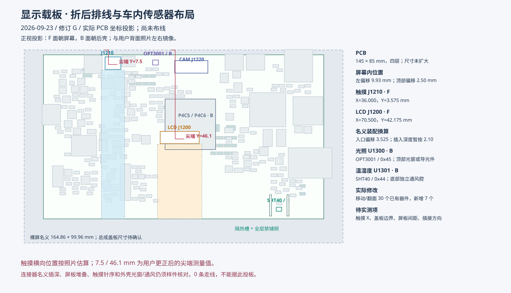

# 修订 M：外壳独立固定，排线绕 PCB 下沿

2026-09-24。按用户要求取消触摸和 LCD 的穿板孔。屏幕与 PCB 分别固定在外壳上，屏幕背面到 PCB 背面的名义间距约 **3 mm**。F 面朝后壳，B 面朝屏幕；器件本体和 FPC 座均在 F 面。

## 接口和排线

坐标从 F 面看向屏幕背面，板框左上角 (0,0)，X 右、Y 下；KiCad 坐标另加 (50,50) mm。板框仍为 145×85 mm。

| 插座 | F 面原点 X / Y（mm） | 相对 L1 下移 | 朝向 |
| --- | --- | --- | --- |
| J1210 触摸 | 109 / 15.5 | 7.925 mm | 0°，入口朝下 |
| J1200 LCD | 74.5 / 54.0 | 7.825 mm | 0°，入口朝下 |
| J1220 摄像头 | 68.5 / 7.0 | 不变 | 180°，入口朝上 |

依据用户背面照片，两条排线均从屏幕下沿引出。当前装配路径为 **屏幕下沿 → PCB 下边缘外侧的弯折空间 → F 面 → 从下向上插入连接器**。插座向下移以缩短从 PCB 下沿到座口的纵向距离；横向位置和针序保持。不要照旧折痕硬拉排线。这个路径和余量仍需实体装配验证。

触摸 (109,15.5) 与 LCD (74.5,54) 是当前连接器原点，不能再解释成旧穿孔中心。两处 FPC 板槽的 52 段 Edge.Cuts 已删除。四个安装孔、两个 1×11 mm 温湿度隔热槽保留；原生板框为一个外轮廓、两个内部隔热开口。

## 排线区域和器件协调

| 无器件区域 | X 范围（mm） | Y 范围（mm） | 用途 |
| --- | --- | --- | --- |
| 触摸排线 | 104.5～113.5 | 19.9～85 | 9 mm 宽、连续到下板沿 |
| LCD 排线 | 63.5～85.5 | 58.2～85 | 22 mm 宽、连续到下板沿 |
| 触摸焊盘出线 | 104～114 | 7.75～12.75 | 5 mm 深 |
| LCD 焊盘出线 | 63.5～83.5 | 41.8～51.25 | 9.45 mm 深，连接核心板至 LCD |

这些区域只禁止放置器件，**允许走线、过孔与铜区**；它们是完整 PCB，不是铣槽。已移除旧穿板槽的四层铜禁布区，避免无意义地切断走线和参考平面。实际 FPC 补强片宽度、最小弯曲半径、绝缘和锁扣开启空间仍待样品核实，不能把区域宽度当成实测排线宽度。

LCD 的 U1200 / U1201 和相关电源、复位、待机小器件移至左侧，对应 26～30 脚；扫描方向电阻 R1206/R1207 在右侧，对应 5/6 脚。主升压 U400/L400 及阻容移至右侧；充电、系统开关、3.3 V 稳压保持分组。FM、板载双麦及相关阻容让开排线。双麦中心变为 U802 (120.5,73)、U803 (60.5,73)，仍相距 60 mm；FM 天线口 J810 改为 (91,81)。声孔及线束按当前坐标核对。

共调整 170 个封装的位置或角度，包含底部测试点。新放置采用封装包围范围之间至少 0.6 mm 的间距；未移动区域维持已有布局。FPC 信号焊盘到其他封装焊盘的最小包围框间距：LCD 约 3.048 mm、触摸约 5.375 mm。这是几何空间核对，不等于已经完成高速扇出或整板布线。

## 3 mm 间距与检查范围

B 面没有器件本体，仍有通孔焊脚。名义露出：PH 接口约 1.80 mm，侧按键约 2.392 mm，侧滑约 1.90 mm。按 3 mm 间距减去模型最大值，最小剩余约 **0.608 mm**；尚未计入焊锡、制造公差、外壳变形及绝缘层，须试装确认。详见 SCREEN_BACK_PROTRUSIONS.json。

354 个封装身份、原理图关联、器件值、DNP、型号和模型绑定保持；1226 个焊盘的 UUID、针号、网名、尺寸及孔径保持。原理图仅更新 FPC 装配说明、日期及首页修订号。项目 DRC 规则与基线逐字节相同。

原生 KiCad 检查：几何 0 违规、ERC 0 错误 / 13 个既有接口警告、物理 DRC 0 违规、SCH/PCB 一致性 0 违规、327/327 实体器件模型可加载。仍为 **0 条走线、848 项未连接**。差分阻抗、实际布通率、电源回路、FM 射频、音频噪声与整机装配均未验收。证据见 SCREEN_BACK_REVIEW.json / VERIFICATION.json；本轮工作区证据在 build/carrier-enclosure/。
