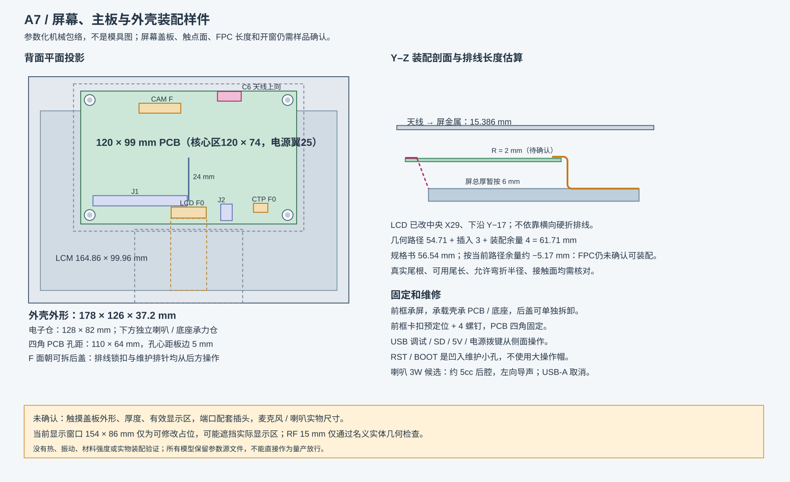

# 新屏 MIPI 适配记录

目标是用户选定的[淘宝商品 983165147604 / SKU 5946336205446](https://item.taobao.com/item.htm?id=983165147604&skuId=5946336205446)：7 寸 1024×600、JD9165、显示屏＋电容触摸左边出线、P+G。MIPI / RGB 是该产品提供的两种接口方式，本主板优先采用 MIPI DSI，不增加 RGB 并行接口。

本次屏幕专项 review 以用户提供的 [LCM-070--A0 规格书](../../../docs/LCM-070--A0%20规格书.pdf) 第 4–10、15 页为基准。第 5 页机械图给出 LCM 外形 **164.86 ±0.3 × 99.96 ±0.3 × 2.8 ±0.3 mm**、有效区 **154.21 × 85.92 mm** 及底部中间 FPC；第 4 页文字层把长度 OCR 成 163.86 mm，和机械图矛盾，开模前必须让供应商书面确认。

A7 已按可拆后盖装配重新布局，LCD/触摸改为 F 面 0°，布线与全板验收须看最终冻结 PCB 的 [VERIFICATION.md](VERIFICATION.md)。所选模组的额定电源、两通道配置、触摸 IC 及 FPC 接触面仍需确认，尚未完成新屏实机点亮。

## 已实施的接口定义

- J302：30 针、0.5 mm。CLK 为 17/18，D1 为 20/21，D0 为 23/24；D2、D3 保留为空脚。其余供电、背光、方向控制、待机、复位及接地针已按 MIPI 针表核对。
- J308：6 针、0.5 mm。1 Shutdown/control、2 VCC、3 GND、4 INT、5 SDA、6 SCL。删除原有 GT911 型号假设，保留 GPIO23 / GPIO22 和 I²C 接口。
- `panel-profile.json` 记录 40 项 CAD 对应关系，包含连接器安装焊盘。`tools/check_display_panel.py` 检查原理图网表与 PCB 焊盘，`tools/check_display_hardware.py` 进行整板核对。
- P4 采用两条 DSI 数据通道。成品屏必须配置为两通道；只设置主机驱动参数不能改变屏幕物理通道配置。

## 电源与初始化 review

商品资料中明确标为 Parallel RGB 24-bit 的参数表列出 3.3 V 和“3×6 chips white LED”。这些参数尚不能作为所选 MIPI 接法的电气额定值。

| 电路 | 规格书典型值 / 范围 | 本板目标与结论 |
| --- | --- | --- |
| LCD VDD | 1.7–2.0 V，典型 1.8 V | U302 ME6211C18M5G-N 固定 1.8 V，匹配；仍需实测上电纹波 |
| AVDD | 典型 9.8 V | R315 已改 22.6 kΩ，按 1.25 V FB 估算约 9.8 V；首板 TP304 实测后定值 |
| VGH | 18–20 V | 电荷泵目标 19 V；由 TP302 在满载和温升下确认 |
| VGL | −8.5…−7.5 V | 原 6.0 V 齐纳超出范围；D310 已换 LMSZ5237BT1G（8.2 V 标称），目标约 −8.2 V，需确认容差/负载 |
| VCOM | 典型 3.3 V | R323=2 kΩ、R322=1 kΩ，按 AVDD≈9.8 V 估算约 3.3 V；TP303 实测确认 |
| 背光 | LED 串约 8.1–9.9 V、180 mA 典型 | ETA1611，R312=1.1 Ω，约 180 mA 目标；须确认灯串数量、最大电压和热裕量 |
| 触摸 VCC | ESP_3V3 | 须确认触摸 IC、电源、Shutdown 极性和 I²C 地址 |

JD9165 芯片资料支持两通道，但 LANSEL 不出现在这张 30 针排线表中。Espressif 默认驱动初始化主要是唤醒与显示命令，不替代模组 LANSEL 配置。须取得这个成品模组的两通道初始化、时序和电源时序。

规格书第 8–9 页的时序必须由固件和硬件共同满足：VDD/VDDIO 稳定后至少等待 1 ms 才释放 RESX，再等待至少 20 µs 才释放 STBYB；关机时先拉低 STBYB，并保持 MIPI 有效数据约 100 ms 后再撤掉 VGH/AVDD/VDD。当前 STBYB 只有 R303 上拉到 PANEL_LCD_VDD，R307 为 DNP 下拉，没有独立 MCU 控制；它只能随 VDD 被动变化，不能证明满足 20 µs 和关机 100 ms 要求。该项在下一版应改为 GPIO 控制的开漏/电平转换，或增加经实测确认的 RC 方案，完成前不能做量产放行。

规格书第 10 页允许 MIPI 时钟 100–500 Mbps，并给出 60 Hz、H 总计典型 1344、V 总计典型 635 的时序范围。本板使用 D0/D1 两个数据通道；板内差分同对长度已通过检查，但 lane 速率、极性、初始化命令和面板实际两通道配置仍需上屏验证。

## FPC 与装配方向

PCB F 面朝可拆背盖，B 面朝屏幕。触摸“左出线”按屏正面观察，在 PCB 背面视图位于 LCD 右侧。两个屏幕接口均为 F 面 0°，入口朝 +Y，从后盖操作锁扣；排线从板下沿圆弧绕入，避开下左 J1。

| 接口 | CAD 位置 / 角度 | 装配方式 |
| --- | --- | --- |
| J302 LCD | F (29, −17) mm / 0° | 中央下沿，入口朝 +Y；规格书第 5 页 FPC 位于屏幕底边中央 |
| J308 触摸 | F (69, −19) mm / 0° | 下右，入口朝 +Y；对应显示正面左出线 |
| J9 摄像头 | F (13, −75) mm / 0° | 长边横向，保留竖插，沿 +Z 插拔 |

PCB 完整板框约 120 × 99 mm，其中核心电路区约 120 × 74 mm，不能从屏幕“7 寸”换算。LCM 164.86 ±0.3 × 99.96 ±0.3 mm 不等于 P+G 触摸盖板完整尺寸。为避开屏金属背板，PCB 相对 LCM 上移 24 mm；外壳样件 178 × 126 × 37.2 mm。按假设屏总堆叠厚 6 mm，C6 天线到屏金属实体最近 15.386 mm；裸 LCM 规格厚度为 2.8 ±0.3 mm，盖板、胶层和背板确认后必须重算。

LCD 以 R=2 mm 的候选路径绕入，中心线约 54.713 mm，加 3 mm 插入与 4 mm 余量约需 61.713 mm；规格书第 5 页的 56.54 mm 是从屏边到接触区域的机械尺寸，短于上述估算约 5.17 mm，不能当作可用尾长。实际尾根、接触面、针 1、厚度、弯曲区域及装配余量均待实测；收到实物后要把 J302 和外壳通道一起重定位。触摸尾线也未确认。显示开窗 154 × 86 mm 为可改占位，须按有效区 154.21 × 85.92 mm 和盖板黑边重新定稿。

先将 PCB 固定到承载壳四角支柱，再从后侧连接和锁定屏尾线。支撑柱、螺钉、合壳面和底座加强筋不能压线。详细结构及实际模型条件性检查见 [MECHANICAL.md](MECHANICAL.md) 和 [enclosure/README.md](enclosure/README.md)。

## 验证边界与资料来源

CAD 检查包括原生 ERC、DRC / 未连接、全部焊盘网表对应、装配表、铜对象网络身份、完整 MIPI 路径长度及装配方向。MIPI 同对长度差目标 ≤0.254 mm，三对平均长度差 ≤0.762 mm。线路必须有连续参考地，实际 100 Ω 差分阻抗需由板厂叠层求解；名义总厚度 1.6 mm 不足以确定阻抗。

该主板尚未进行新屏实物点亮、触摸、热测试、EMC 和外壳装配验证。模组电气参数、两通道配置及机械确认是后续打样和上屏前必须闭合的事项。

- 用户提供的选中规格、MIPI 针表和触摸针表已用于复核；原商品 HTML 含私人账户信息，不随工程提交。当前项目目录未检索到原 HTML / 图片副本，下列文件名仅作为已读资料的索引。
- [LCM-070--A0 规格书（本地）](../../../docs/LCM-070--A0%20规格书.pdf)：第 5 页机械外形/FPC，第 6 页 30 针定义，第 7 页电源参数，第 8–9 页上/下电时序，第 10 页 MIPI 时序，第 15 页装配注意事项。
- MIPI 针表：`O1CN01Dea86t1iXKUyfv1qf_!!2640614422.jpg`；触摸针表：`O1CN01oT1DSe1iXKUyjQ6FC_!!2640614422.jpg`。
- [JD9165A-A 数据手册](https://dl.espressif.com/AE/esp-iot-solution/JD9165A-A_DS_V0.0.1-0621.pdf)。
- [Espressif JD9165 驱动 2.0.2](https://components.espressif.com/components/espressif/esp_lcd_jd9165/versions/2.0.2)。
- [ESP32-P4 PCB 布局指南](https://docs.espressif.com/projects/esp-hardware-design-guidelines/en/latest/esp32p4/pcb-layout-design-esp32p4.html)。
