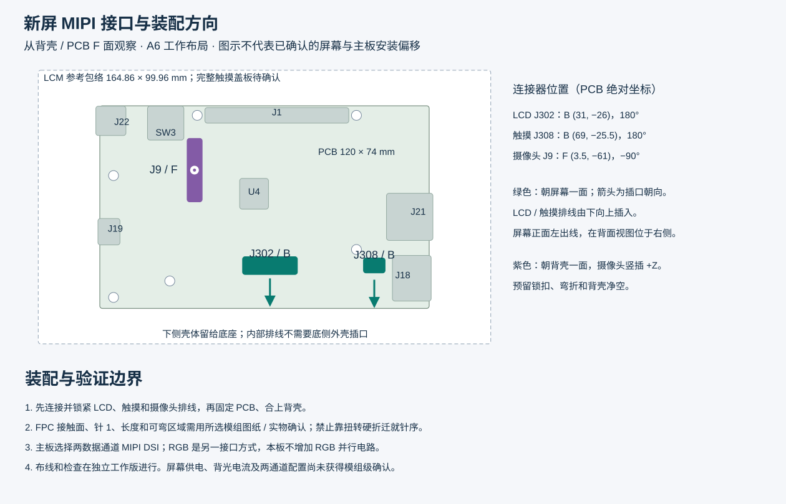

# 新屏 MIPI 适配记录

目标是用户选定的[淘宝商品 983165147604 / SKU 5946336205446](https://item.taobao.com/item.htm?id=983165147604&skuId=5946336205446)：7 寸 1024×600、JD9165、显示屏＋电容触摸左边出线、P+G。MIPI / RGB 是该产品提供的两种接口方式，本主板优先采用 MIPI DSI，不增加 RGB 并行接口。

A6 原理图与 PCB 布线已完成，原生 ERC / DRC / 未连接检查均为 0，完整记录见 [VERIFICATION.md](VERIFICATION.md)。这是 CAD 检查通过状态；所选模组的额定电源、两通道配置、触摸 IC 及 FPC 接触面仍需确认，尚未完成新屏实机点亮。

## 已实施的接口定义

- J302：30 针、0.5 mm。CLK 为 17/18，D1 为 20/21，D0 为 23/24；D2、D3 保留为空脚。其余供电、背光、方向控制、待机、复位及接地针已按 MIPI 针表核对。
- J308：6 针、0.5 mm。1 Shutdown/control、2 VCC、3 GND、4 INT、5 SDA、6 SCL。删除原有 GT911 型号假设，保留 GPIO23 / GPIO22 和 I²C 接口。
- `panel-profile.json` 记录 40 项 CAD 对应关系，包含连接器安装焊盘。`tools/check_display_panel.py` 检查原理图网表与 PCB 焊盘，`tools/check_display_hardware.py` 进行整板核对。
- P4 采用两条 DSI 数据通道。成品屏必须配置为两通道；只设置主机驱动参数不能改变屏幕物理通道配置。

## 电源与初始化仍需确认

商品资料中明确标为 Parallel RGB 24-bit 的参数表列出 3.3 V 和“3×6 chips white LED”。这些参数尚不能作为所选 MIPI 接法的电气额定值。

| 电路 | 当前名义设置 | 适配边界 |
| --- | --- | --- |
| LCD VDD | U302 ME6211C18M5G-N，1.8 V | 固定输出；R313 是使能上拉，不能用它调输出电压 |
| AVDD / VGH / VGL / VCOM | 约 9.6 / 18 / −6 / 3.2 V | 保留参考电路设置，尚未获新模组工作点确认 |
| 背光 | ETA1611，R312 1.1 Ω，约 182 mA | 须确认灯串、电流和最大电压后定值 |
| 触摸 VCC | ESP_3V3 | 须确认触摸 IC、电源、Shutdown 极性和 I²C 地址 |

JD9165 芯片资料支持两通道，但 LANSEL 不出现在这张 30 针排线表中。Espressif 默认驱动初始化主要是唤醒与显示命令，不替代模组 LANSEL 配置。须取得这个成品模组的两通道初始化、时序和电源时序。

## FPC 与装配方向

PCB F 面朝背壳，B 面朝屏幕。选中照片里的触摸“左出线”是从显示正面看；从背面看位于 LCD 排线右侧。照片中排线从屏幕下方伸出，因此两个屏幕接口都放在 B 面中下部，插口朝 +Y、排线沿 −Y 插入。

| 接口 | CAD 位置 / 角度 | 装配方式 |
| --- | --- | --- |
| J302 LCD | B (31, −26) mm / 180° | 面向屏幕，插口朝下 |
| J308 触摸 | B (69, −25.5) mm / 180° | 面向屏幕，对应正面左出线 |
| J9 摄像头 | F (3.5, −61) mm / −90° | 面向背壳竖插，预留锁扣和弯折空间 |

图中 LCM 与 PCB 居中仅为比较假设。PCB 120×74 mm 来自电路及外壳接口布局；不能从屏幕“7 寸”直接换算。商品 LCM 图为 164.86±0.3×99.96±0.3 mm，不等于左出线 P+G 触摸盖板的完整外形。

现有 FPC 封装是基于参考几何的候选，接触面、针 1、排线厚度、伸出长度、可弯区域及装配间距仍需实物 / 图纸确认。先锁紧内部排线，再固定主板和后盖；支撑柱、螺钉、加强筋和底座受力结构不得夹住排线。

## 验证边界与资料来源

CAD 检查包括原生 ERC、DRC / 未连接、全部焊盘网表对应、装配表、铜对象网络身份、完整 MIPI 路径长度及装配方向。MIPI 同对长度差目标 ≤0.254 mm，三对平均长度差 ≤0.762 mm。线路必须有连续参考地，实际 100 Ω 差分阻抗需由板厂叠层求解；名义总厚度 1.6 mm 不足以确定阻抗。

该主板尚未进行新屏实物点亮、触摸、热测试、EMC 和外壳装配验证。模组电气参数、两通道配置及机械确认是后续打样和上屏前必须闭合的事项。

- 用户提供的选中规格、MIPI 针表和触摸针表已用于复核；原商品 HTML 含私人账户信息，不随工程提交。当前项目目录未检索到原 HTML / 图片副本，下列文件名仅作为已读资料的索引。
- MIPI 针表：`O1CN01Dea86t1iXKUyfv1qf_!!2640614422.jpg`；触摸针表：`O1CN01oT1DSe1iXKUyjQ6FC_!!2640614422.jpg`。
- [JD9165A-A 数据手册](https://dl.espressif.com/AE/esp-iot-solution/JD9165A-A_DS_V0.0.1-0621.pdf)。
- [Espressif JD9165 驱动 2.0.2](https://components.espressif.com/components/espressif/esp_lcd_jd9165/versions/2.0.2)。
- [ESP32-P4 PCB 布局指南](https://docs.espressif.com/projects/esp-hardware-design-guidelines/en/latest/esp32p4/pcb-layout-design-esp32p4.html)。
