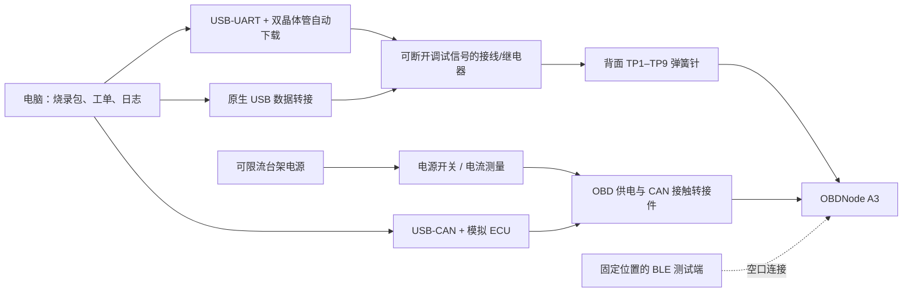

# OBDNode A3 烧录与测试夹具：单工位 V1

ESP32-C3FH4X 焊在板上后，仍能通过芯片 ROM 中的下载程序烧录内置 Flash。**A3 已集中布置 9 个背面测试触点，包含 5 V 检测点；采用专用弹簧针床、一圆一槽定位与压盖，烧录器使用 USB 转串口成品模块，电脑负责流程与记录。V1 不需要另加夹具 MCU。**

本目录交付的是接线／流程设计、从实际 PCB 导出的触点与定位孔坐标、参考图和可执行主机工具。夹具接口 PCB、机械加工件和实物尚未制作；没有进行真实烧录或 CAN／BLE／电流测试。当前主板仍是 A3 工程原型，现有插头适配及焊后探针空间未确认，不能因文件检查通过就标为产品出厂合格。

## 1. 单工位结构



V1 采用手动压盖、手动供电开关和可拔插调试线，先验证一块板的完整工艺。批量需要时再增加压盖检测、供电与信号继电器控制、扫码和自动功能测试；可采用现成 USB I/O 模块控制继电器，无须为烧录本身另写 MCU 固件。

| 项目 | V1 选择／要求 | 作用 |
|---|---|---|
| 烧录接口 | CP2102N USB 转串口模块，**3.3 V TTL，必须引出 DTR、RTS** | ROM 下载和 UART0 日志 |
| 自动下载 | 按 Espressif ESP32-C3-DevKitM-1 的双晶体管电路，或已核实采用同类电路的成品板 | 控制 GPIO9 与 EN；串口模块本身不一定带此电路 |
| 原生 USB 转接 | USB 线／转接板引出 D−、D+、GND；VBUS 留在夹具侧 | 当前应用的 AT 命令入口与 USB 调试 |
| 针床 | 9 个独立可更换弹簧针，压盖和绝缘定位底座 | 接触集中背面焊盘，2 mm 节距 |
| OBD 转接 | 裸 PCBA 专用供电／CAN 接触件；成品使用配对的 OBD 母座 | 引入 16、4、5、6、14 脚 |
| 电源 | 可限流、可关断的台架电源，功能测试初始用 13.2 V | 覆盖主板输入保护、降压、LDO |
| CAN 测试 | 支持经典 CAN 250/500 kbit/s、11/29 位 ID 的 USB-CAN | 模拟 ECU 应答，检查收发和计数 |
| 电流测量 | 适合 μA/mA 量程且已知负担电压的仪表；能承受唤醒峰值 | 检查休眠、周期唤醒和输入电压 |
| BLE 测试端 | 首版使用现有 Android App，固定位置；后续用专用测试软件 | 空口连接、命令响应和数据完整性 |

普通开发板上的自动下载电路若作为转接器复用，必须先断开其原有目标 MCU 的 EN／BOOT／UART，避免两个目标互相驱动。优先采购独立烧录转接器；不能将 USB-UART 的 5 V TX 接到 C3。

## 2. 电气接线

以下坐标原点为 PCB 板框左上角，**从正面看，x 向右、y 向下**；实际触点在背面。`contacts.csv` 同时提供翻面后的针床观察坐标；`contact-map.svg` 在 100% 打印时为 1:1，打印后先量 20 mm 标尺。

| 触点 | 网络 | 正面投影 x / y（mm） | 夹具连接 |
|---|---|---|---|
| TP1 | GND | 15.20 / 15.00 | 公共地 |
| TP2 | +3V3 | 17.20 / 15.00 | 高阻电压检测；**不作为供电输入** |
| TP9 | +5V | 19.20 / 15.00 | 高阻电压检测；**不作为供电输入** |
| TP7 | USB_DM / GPIO18 | 21.20 / 15.00 | USB D− |
| TP8 | USB_DP / GPIO19 | 23.20 / 15.00 | USB D+ |
| TP3 | EN | 25.20 / 15.00 | 自动下载电路的开集电极复位输出 |
| TP4 | BOOT / GPIO9 | 27.20 / 15.00 | 自动下载电路的开集电极下载输出 |
| TP5 | U0RX / GPIO20 | 29.20 / 15.00 | 夹具 TX → 节点 RX |
| TP6 | UART_TX / GPIO21 | 31.20 / 15.00 | 夹具 RX ← 节点 TX，板上串联 R12 499 Ω |

**最小 UART 烧录连接是 TP1、TP3、TP4、TP5、TP6 加整板供电；V1 针床装齐 9 针，兼顾两路电压检测和 USB 功能测试。** UART0 用于 ROM 烧录与日志；当前固件的 AT 输入通过 `usb_serial_jtag_read_bytes()` 读取，不在 UART0 上。C3 也能从原生 USB 下载，但 UART 自动下载保留为稳定的恢复入口。[官方 USB Serial/JTAG 文档](https://docs.espressif.com/projects/esp-idf/en/v5.5/esp32c3/api-guides/usb-serial-jtag-console.html)

供电从 OBD **16 脚输入，4/5 脚接地**，CAN_H 为 6 脚、CAN_L 为 14 脚。节点电路为 F1 → D1 → VIN_PROT → 5 V 降压 → 3.3 V LDO。直接给 TP2 注入 3.3 V 会绕开输入电路，并存在向稳压器反向供电的问题。TP7/TP8 没有 USB VBUS 输入，USB 5 V 不接任何主板测试点。

初次板卡上电先断电测电源对地短路，再以限流电源观察启动；可先以约 50 mA 限流排查明显短路，再断电、提高限流重新启动。低限流下 C3 不一定能启动，不能据此判定 MCU 损坏。功能测试的初始限流上限设 500 mA，须依据样机启动峰值和板上 500 mA 保险丝实际曲线调整。**这些是台架起始设置，不是已测定的良品电流窗口。**

功能测试用 13.2 V 输入是为避开当前固件的低电压休眠阈值。`ATRV` 读的是二极管后的 VIN_PROT，应另用仪表测电池端电压、TP9 的 5 V 和 TP2 的 3.3 V；12.0 V 台架输入可能因二极管压降触发低电压休眠。A3 的 TP9 是专用 5 V 检测点，不与夹具 USB VBUS 相连。

### 自动进入下载模式

GPIO9 在复位采样时为低、GPIO8 为高，进入 ROM 下载；正常启动时释放 GPIO9。主板已有 GPIO8／GPIO9 上拉及 EN 的 1 μF 电容。双晶体管自动下载电路将 DTR／RTS 转为 EN／GPIO9，避免串口打开时两路同时拉低导致一直复位。

| DTR 实际电平 | RTS 实际电平 | EN | GPIO9 |
|---|---|---|---|
| 1 | 1 | 1 | 1 |
| 0 | 0 | 1 | 1 |
| 1 | 0 | 0 | 1 |
| 0 | 1 | 1 | 0 |

此表为电线上的逻辑电平，不能直接当作 pyserial 的布尔值。连接依据 [Espressif 官方自动下载说明](https://docs.espressif.com/projects/esptool/en/latest/esp32c3/advanced-topics/boot-mode-selection.html) 和 [ESP32-C3-DevKitM-1 原理图第 2 页](https://dl.espressif.com/dl/schematics/SCH_ESP32-C3-DEVKITM-1_V1_20200915A.pdf)。主机工具调用 esptool 的 `default_reset`，不自行用不可靠的延时模拟下载时序。

## 3. 针床与装配顺序

板框 38.5 × 16.6 mm、双面有器件。A3 新增 H1 Ø1.2 mm 圆孔及 H2 1.6 × 1.2 mm 水平槽孔，均非金属化；中心分别为 (2.0,15.0)、(34.3,15.0) mm，中心距 32.3 mm。这是一圆一槽定位，不是螺丝紧固孔；非对称位置用于防反装。针座定位、探针有效行程与压力需要和选定探针一起确定；1 mm 焊盘可先评估约 0.5 mm 接触头，但不能把这个建议值直接当针座钻孔直径。

顶面已预留两处 1.2 × 1.2 mm 支撑区，中心 (15.0,15.0)、(32.5,15.0) mm，并有禁止焊盘／过孔的原生规则。使用平面绝缘压块，不能压芯片、晶振或陶瓷天线。背面要求插头及外壳让出 x=14.2–32.2、y=13.9–16.4 mm 的探针窗口；实际是否让得出仍需该插头尺寸。详见 [焊接与定位接口](../obd-ble-node/manufacturing-interface.md)。`locators.csv` 包含从最终 PCB 导出的定位孔信息。

从针尖朝 PCB 背面看，并保持 PCB 同一条上边朝上：**针床 x = 38.5 − 正面 x，针床 y = 正面 y。** `needle_face_*` 已经镜像，不得再次镜像。坐标文件来自实际 `.kicad_pcb`，不是只从原理图推断。

图中 J1 的位置是 OBD 槽孔中心，**不是可以直接放普通尖头探针的位置**：针尖会落入槽孔，焊完插头后也可能顶到焊脚。裸板转接件应接触选定的铜环／使用适配接触头，待实物试配；成品测试使用 OBD 配对母座。现有插头尾脚及塑料本体尚未实测，不能据板端 J1 坐标直接放行夹具加工。

建议装配工序：

1. SMT 回流、AOI／必要的 QFN 焊接检查。
2. **裸 PCBA 入针床：烧录、初步 USB／CAN／BLE 测试。**
3. 焊接 OBD 插头，检查焊接质量。
4. 使用 OBD 母座供电与 CAN，BLE 空口执行整机复测和低功耗检查。
5. 入壳、抽检射频与装配、贴追溯标签。

这个顺序避免插头塑料本体挡住背面触点。只有确认焊后仍有探针行程空间，才把烧录工位移到插头焊接之后。底座的 3D／CNC 加工图需以实物板和插头试配冻结；本目录 SVG 仅用于针位和方向复核。

正面右上角 x=35.25–38.5、y=0–5.25 mm 为现有射频净空区。夹具在其周围预留空气空间，不放金属压块、针座或支撑柱。BLE 测试的位置、距离、方向固定；量产 RSSI 窗口须通过良品样本建立，不能在图纸阶段随意设一个数值。

## 4. 每块板的流程与结果

| 顺序 | 操作 | 结果判定／追溯 |
|---|---|---|
| 1 | 断电装板、压盖定位、录入工单 SN 与工位编号 | 未压紧不供电；V1 人工确认，V2 增加联锁 |
| 2 | 输入、5 V 与 3.3 V 检查、观察启动电流 | 异常先断电，禁止循环强行烧录 |
| 3 | 指定 UART COM，ROM 连接、读取芯片 MAC | `--chip esp32c3` 校验目标；没有 MAC 不写入 |
| 4 | 写 bootloader、partition-table、app，再读回校验 | `FLASH_VERIFIED`；保存镜像 SHA256、版本、MAC、时间和完整输出 |
| 5 | 重启，通过原生 USB 执行 ATI、ATRV、ATPOWER?、ATSTAT | 核对身份、电压、策略和错误计数 |
| 6 | 首次新板初始化记录区，测试一次记录／导出 | **新板才显式执行 ATLOGFMT**；返修不得自动格式化 |
| 7 | CAN 请求／应答与被动监听；BLE 发送命令和接收数据 | 真正的台架总线和空口验证，不能用电脑假响应替代 |
| 8 | 停止主机请求、物理断开调试信号，测自动休眠与电流 | 电流限值和稳定时间经样机验证后冻结 |
| 9 | 保存人工／仪表 FCT 记录，确认全部合格才放行 | 烧录脚本不会自动给出 FCT_PASS |
| 10 | 断电、释放压盖、取板／扫码贴标 | 标签 SN 与 ROM MAC、工单记录关联 |

工具记录的 `rom_mac` 为芯片 ROM 读出的 MAC 标识，不保证等于应用广播的 BLE 地址。当前 SN 只写入电脑记录，**没有向主板烧写唯一序列号或出厂校准数据**。源代码版本由制包人员提供，工具校验的是镜像字节，不证明镜像一定对应填写的 Git 提交；发布包需由受控构建生成并审核。

### CAN 与 BLE 台架用例

节点本身不加 120 Ω。独立测试总线两端各装 120 Ω 终端；断电测 CAN_H/CAN_L 约 60 Ω，确认工具内置终端没有重复接入。功能测试连接模拟 ECU，避开真实车辆。

先选择 `ATSP6`（11 位、500 kbit/s），USB 或 BLE 每次发送 CR 结尾命令，等待 `>` 后再发下一条。BLE 使用 FFF0 服务，订阅 FFF1，再向 FFF2 写入。

| 请求 | 模拟 ECU 从 0x7E8 返回的数据字节 | 预期 |
|---|---|---|
| 010C | 04 41 0C 1F 40 00 00 00 | 2000 rpm |
| 010D | 03 41 0D 28 00 00 00 00 | 40 km/h |
| 0105 | 03 41 05 7D 00 00 00 00 | 85 °C |

请求由节点经 CAN 发出，模拟 ECU 必须收到匹配请求才应答。例如 010C 的广播请求 ID 为 0x7DF，数据为 `02 01 0C 00 00 00 00 00`。检查 ATSTAT 的收发和错误计数；ATMA 另测被动帧与时间顺序。产品覆盖的 250 kbit/s、29 位 ID 也需分别测试，不能用一条 500 kbit/s 测试代表所有模式。

V1 的 CAN 仿真、Android BLE 测试与测试结果合并仍按上述用例人工完成，未伪装为脚本已自动执行的步骤。USB-CAN 型号和 API 确定后再加入自动应答器。

### 低功耗测试必须隔离调试信号

当前固件在 USB 枚举连接时旁路自动休眠。只关闭串口软件还不够：**测停车电流前，在 DUT 侧断开 USB D+/D−、UART TX/RX、EN、BOOT 及有泄漏风险的测量支路，保持 OBD 电源和地。** V1 拔开调试接线；V2 使用适配 USB 全速的开关或经验证的继电器方案，并防止 DUT 断电后被串口引脚反向供电。

停止 CAN 功能请求，BLE 客户端不再请求数据。确认默认 60 秒超时后进入深睡眠；观测自动休眠比只发 ATSLEEP 更能覆盖实际策略。测量时检查仪表负担电压与切档是否造成复位，不能把掉电当成低电流。另测持续低电压、CAN 背景报文、连续无人唤醒及 BLE 连接但无数据请求。

工程目标是电池端长期平均电流 ≤0.5 mA，尚未实测。每板可测一次入睡和稳定电流，抽样至少覆盖多次默认 900 秒周期唤醒，并做 24 小时记录；几秒钟的睡眠电流读数不能证明长期平均值达标。VIN_PROT 的阈值和电池端存在二极管压降，量产前应建立校准与误差范围。

## 5. 主机工具使用

Python 3.10+、esptool 4.12.0。本机 ESP-IDF v5.5.5 环境已包含它；新工位在独立虚拟环境安装 `requirements.txt`。工具只在显式 `flash` 子命令中连接串口，`package` 与 `inspect` 均为离线操作，无自动端口选择。

在仓库根目录的 ESP-IDF v5.5.5 PowerShell 中：

```powershell
./firmware/obd_ble_node/build.ps1 build
python hardware/obd-programming-fixture/station.py package --build firmware/obd_ble_node/build --out hardware/obd-programming-fixture/build/packages/A3-001 --hardware A3 --source-revision <已核对的源码提交>
python hardware/obd-programming-fixture/station.py inspect hardware/obd-programming-fixture/build/packages/A3-001
```

包从本次构建的 `flasher_args.json` 取文件和地址，同时严格限制为当前 A2/A3 共用的分区布局：bootloader 0x0、partition-table 0x8000、app 0x10000；检查 C3 镜像头、内置校验、SHA256 和分区边界。`--hardware` 默认 A3，旧板制包可显式选择 A2；此字段仅标识工单目标，未实现板上硬件版本检测。若布局改变，工具拒绝执行，需要重新审查烧录流程。不会将稀疏镜像合并为会覆盖中间 NVS 的整片镜像。

下列是**连接并写入真实节点**的操作模板，COM 和 SN 必须由当前工位实际识别并填写；本次没有执行：

```powershell
python hardware/obd-programming-fixture/station.py flash hardware/obd-programming-fixture/build/packages/A3-001 --port <实际UART端口> --serial <本块板SN> --station OBD-01 --reports hardware/obd-programming-fixture/build/reports
```

运行顺序为 `read_mac → write_flash → verify_flash`；每步检查退出码，身份无法读取或任何一步失败立即停止，并记录 `FAILED`。成功记录为 `FLASH_VERIFIED`、`fct_status: NOT_RUN`。输出目录应由工厂系统备份，当前本地 `build/` 不入 Git，不能作为唯一生产档案。

工具不执行 erase_flash、eFuse 写入、Secure Boot 或 Flash Encryption 配置，不使用 `--force`。已启用安全烧录的芯片应进入独立受控工位处理。当前固件无 OTA 双分区和签名升级闭环；V1 保留触点返修，量产升级与密钥策略另行验证。

## 6. 本次验证与下一版范围

- 使用 KiCad 10 原生 API 读取最终 A3 PCB，核对 TP1–TP9 的网络、背面铜／阻焊层、1 mm 焊盘和板框尺寸；导出 9 个测试点、5 个 OBD 参考位置及 2 个定位孔。插头焊后可触及性仍未实测。
- 此前使用 ESP-IDF v5.5.5 的 A2 构建产物完成离线制包与命令预览；A3 只调整测试／定位布局，固件引脚未变。本轮未打开设备端口。
- 14 项主机测试通过，覆盖镜像篡改、错误目标、越界／分区漂移、身份缺失、烧录／校验失败和记录状态；模拟串口输出仅验证工具控制流程，不代表硬件测试。
- 主板 PCB 已更新为 A3，完整 ERC／DRC／连通／原理图一致性通过；固件及连接设备未变更。针床机械装配、接触可靠性、下载时序、USB 信号、CAN/BLE、电流与治具节拍均待实体样机。

重新导出针位：

```powershell
& 'C:/Program Files/KiCad/10.0/bin/python.exe' hardware/obd-programming-fixture/export_contacts.py
python -m unittest discover -s hardware/obd-programming-fixture -p 'test_*.py' -v
```

A3 已集中背面测试点、补 5 V 点并加入定位／支撑结构，保留陶瓷天线净空。下一步需取得实际插头背面尺寸并试配，确认焊后探针窗口与定位销路径，再冻结底座加工图。**先做这套单工位针床原型，确认良品和故障样本的实际表现，再画集成继电器／测量接口的夹具 PCB，最后考虑多工位并行。**
